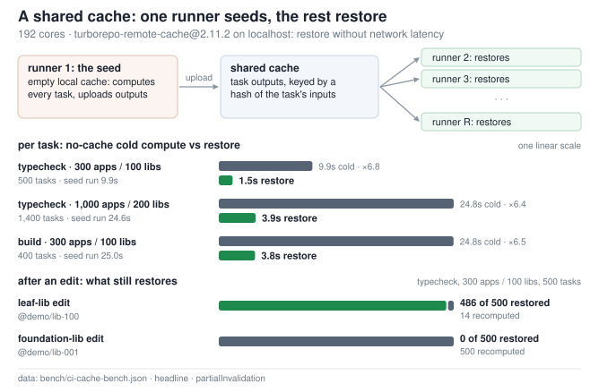
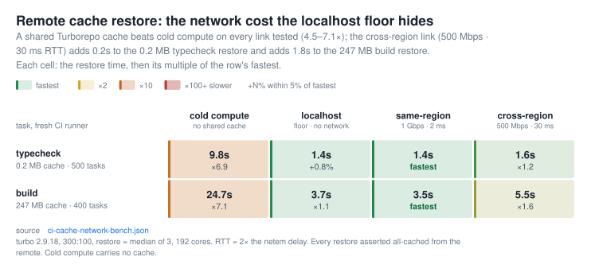

# Limits and Gotchas at 20k Apps

What focus, caching, and `--affected` cannot save you from, and the gotchas this build hit. Numbers are from [the workspace under test](README.md#the-workspace-under-test) at the stated scales unless a distinct corpus is named.

## Irreducible Limits at 20k

Scoping and caching reduce *execution*. These costs remain because they are inherent to one workspace graph and one lockfile.

1. **The single lockfile.** One `pnpm-lock.yaml` describes the whole workspace: 10,185 → 746,255 lines across 300 → 20,300 packages (34–37 lines/package; 21,019,478 bytes at 20,000 apps, `results.json`). Every install reads it and any dep change rewrites it, so every dep-touching branch is a merge-conflict surface. You cannot `--filter` it. The mitigations trade away its value ([OPTIMIZATIONS.md §1.5](OPTIMIZATIONS.md#15-lockfile-churn-and-merge-conflicts)): `shared-workspace-lockfile=false` loses cross-package dedup, and git-branch lockfiles avoid conflicts but not size. pnpm 12 enables git-branch lockfiles via `pnpm-workspace.yaml` `gitBranchLockfile: true` and ignores the npm-style `.npmrc` key (`bench/lockfile-merge-bench.json`).

2. **The Turbo graph-load floor.** `--filter`, `--affected`, and `prune` all parse every `package.json` and build the full DAG *before* selecting a subset: O(repo) on every invocation, including no-ops. A fully-cached `turbo run typecheck` grew 1.0s → 23.9s from 200 to 10,000 apps (`results.json`, 192-core box). Scoped commands pay the same term at fixed output. At 2,000 / 5,000 / 20,000 apps, `turbo prune` emits the same-sized 101-package subtree in 1.9s / 4.4s / 25.0s, and a focused build of a 100-package closure takes 11.9s / 15.4s / 39.5s. At 20,000 apps a scoped command costs 23–28s more than the same-sized selection at 2,000 (prune +23.1s, focused build +27.6s). Turbo's only escape is to stop having one graph (shard), which gives up atomic cross-package changes.

   Vite Task (Vite+'s fs-traced runner) keeps its focused warm run flat as the workspace grows 3× (400 → 1,200 tasks; the focused selection is 61 and 56 tasks): 0.81s → 0.83s, where turbo's grows 0.76s → 1.01s. turbo is the faster of the two in the 400-task workspace, vp by 1.2× in the 1,200-task one. The trade is a whole-repo typecheck 8.4–10.7× slower cold and 3.2–4.1× slower warm (`bench/vite-task-bench.json`, [TOOLING.md](TOOLING.md#vite-vp-task-runner-and-tool-layer)).

3. **Foundation/root-change blast radius = the whole repo.** A change to a widely used lib or a root input (`tsconfig.base.json`, the catalog React/Next version, the pnpm/turbo/next version; all are in every task's hash) invalidates the cache for every dependent.
   - Editing low-layer `lib-003` rebuilds 1,080 of 1,200 packages; at 20k that is ~18k.
   - `test` has the same shape (`bench/test-axis-bench.json`, 1,000:200): a universal-foundation edit re-tests 1,200 of 1,200 packages, a leaf edit 21 (~57× spread). The cold wall-clocks (12.0s vs 2.7s) run minimal smoke bodies, so they bound Turbo orchestration plus `node --test` startup, not real suite runtime; the count is the evidence.
   - A remote cache helps only consumers after the first; after a foundation edit it restores nothing (see [Remote Cache](#remote-cache-amortizing-the-orepo-cold-start)).
   - For the unavoidable whole-repo case, the lever is sharding independent test tasks across machines (1,200 → 150/shard at eight shards).

   The fix is organizational: change foundations rarely.

4. **Materializing the whole tree (inodes/disk).** Installing all 20k apps creates a `node_modules` per package. Isolated-linker symlinks go from 3,011 at 200 apps / 100 libs to 241,712 (of 374,827 `node_modules` entries) at 20,000 apps / 300 libs (`results.json`), plus the `.pnpm` store. 40 Next apps produce 156 MB of `.next`, so 20k ≈ 78 GB; inodes can exhaust a modest filesystem. The levers are `node-linker=pnp` and not building everything.

5. **Editor / language server.** Opening *one app* is O(closure): the server loads that app's closure (65 libs / 1,123 files), flat as the repo grows 8× (see [Editor and Language Server](#editor-and-language-server)). Opening the *whole* workspace as one project at 20k is O(repo): a multi-GB program with slow cross-package IntelliSense. Sub-tree opens, sparse-checkout, and PnP with an editor SDK scope it back to a closure.

6. **git at 20k.** ~130k+ source files. `git status`, `checkout`, and `clone` are O(worktree) and need `fsmonitor`, `sparse-checkout`, and partial clone (a Scalar-style setup).

7. **Deploy-platform per-project model.** Vercel uses one project per app but caps projects per repo (Pro: 60; [Vercel limits](https://vercel.com/docs/limits)), so 20k apps split across repos or teams, itself a sharding pressure. Vercel's native "skip unaffected projects" does not consume a concurrent build slot; the deprecated `turbo-ignore` Ignored Build Step does. Use `turbo run --affected` plus the native skip.

pnpm + Turborepo's single-graph, single-lockfile model has a ceiling where graph load, the lockfile, and foundation blast radius dominate. The workaround is to stop having one graph: shard into independent workspaces, or move to a daemon + remote-execution build system (Bazel/Buck2 with a build farm).

## Remote Cache: Amortizing the O(repo) Cold Start

Every CI runner starts with an empty local cache. Turborepo stores each task's outputs (the built files for a `build`; the checker's exit status and logs for a `typecheck`) under a hash of the task's inputs: its own source, its dependencies' cached outputs, and global inputs such as `tsconfig.base.json` and the pinned tool versions. A remote cache (`turborepo-remote-cache@2.11.2`, on localhost) shares those outputs across machines, so a later runner with the same input hash *restores* the output instead of recomputing it (Figure 1). Per task and scale (`bench/ci-cache-bench.json`, 192-core c8g.48xlarge), typecheck restores 6.8× faster than no-cache cold at 300:100 (1.5s vs 9.9s) and 6.4× at 1,000:200 (3.9s vs 24.8s); build restores 6.5× faster at 300:100 (3.8s vs 24.8s). Restore is itself O(repo): it skips execution but pays Turbo's graph load and hashing, so it grows with the repo (1.5s → 3.9s) and the ratio holds at ~6.4–6.8× rather than widening. The ratio is specific to the box: the cold side is core-bound compute (`env.coreBound` in the record), the restore is not.

[High-resolution PNG](bench/charts/fig-remote-cache.png)

**Figure 1.** The first runner to compute a task uploads its outputs, and every later runner with the same inputs downloads them. An edit changes only the hashes of the tasks downstream of it, so a leaf edit leaves most tasks restorable and a foundation edit none.

Figure 1 fields

`bench/ci-cache-bench.json`: per `headline` row `task`, `scale`, `apps`, `libs`, `totalTasks`, `coldNoRemoteMs`, `coldSeedMs`, `restoreMs`, `speedupVsCold`; `partialInvalidation` — `task`, `scale`, `apps`, `libs`, `totalTasks`, and per `leaf`/`foundation` `lib`, `restored`, `recomputed`, `total`; `env.cores`, `versions.remoteCacheServer`, `remoteCache.transport`, `samples.{cold,buildCold,restore}`, `concurrency`.

**Someone still pays the first build.** The first runner computes and uploads (the "seed"). On localhost the seed cost is within compute noise; over a network it is the artifact transfer.

**Across a fleet it amortizes.** With R runners building the identical closure, the first seeds and R−1 restore, so per-runner cost converges toward the restore time (3.9s at 1,000:200; 10 runners amortize 4.2×, 50 runners 5.8×). A real fleet builds different commits, so reuse is partial and the factor lower (`bench/ci-cache-bench.json`).

**The network cost, measured.** Shaping the loopback with `tc netem` prices the transfer the localhost floor leaves out (`bench/ci-cache-network-bench.json`, 300:100, 192-core c8g.48xlarge; RTT = 2× the netem delay):

[High-resolution PNG](bench/charts/cache-network.png)

<!-- chart-data:cache-network -->

The numbers as a table (fastest in bold; readable on a phone)

A shared Turborepo cache beats cold compute on every link tested (4.5–7.1×); the cross-region link (500 Mbps · 30 ms RTT) adds 0.2s to the 0.2 MB typecheck restore and adds 1.8s to the 247 MB build restore. Each cell: the restore time, then its multiple of the row's fastest.

| task, fresh CI runner | cold compute (no shared cache) | localhost (floor · no network) | same-region (1 Gbps · 2 ms) | cross-region (500 Mbps · 30 ms) |
| --- | ---: | ---: | ---: | ---: |
| typecheck (0.2 MB cache · 500 tasks) | 9.8s (×6.9) | 1.4s (+0.8%) | **1.4s** | 1.6s (×1.2) |
| build (247 MB cache · 400 tasks) | 24.7s (×7.1) | 3.7s (×1.1) | **3.5s** | 5.5s (×1.6) |

[`bench/ci-cache-network-bench.json`](bench/ci-cache-network-bench.json). turbo 2.9.18, 300:100, restore = median of 3, 192 cores. RTT = 2× the netem delay. Every restore asserted all-cached from the remote. Cold compute carries no cache.

<!-- /chart-data:cache-network -->

Network cost grows with cache **size**. Same-region, both restores sit inside the spread of their own localhost samples (typecheck 1.40–1.56s, build 2.4–4.1s). The cross-region profile (500 Mbps and 30 ms RTT, varied together) adds 0.2s to the 0.2 MB typecheck restore and 1.8s to the 247 MB build restore. Every restore stays ×4.5–×7.1 under the cold compute it replaces (typecheck ×6.9 on localhost to ×6.0 cross-region; build ×6.7 to ×4.5), so the shared cache wins on every link measured.

**It cannot help when an edit changes everything.** A remote cache restores only artifacts an edit did not invalidate (Figure 1; `bench/ci-cache-bench.json`, 300:100 under `--universal 1`, 500 tasks). A leaf edit leaves **486 of 500** restored and 14 recomputed; a foundation edit leaves **0 of 500** restored. This is §3's blast radius from the cache's side: scope an edit and the cache absorbs the rest; touch a foundation and someone pays the full cold rebuild.

## Editor and Language Server

Before answering a keystroke, the language server loads a project. The bench races `tsserver` (VS Code's) against `tsgo --lsp` (since GA, `typescript@7`'s native `tsc --lsp`), each opening one app's `page.tsx`. Cross-package navigation resolves to source without a build (tsconfig `paths` → `packages/*/src`), which pulls the app's real closure (65 libs / 1,123 files at 4,000:300) into the server (`bench/editor-loop-bench.json`; tsgo 7.0.2, typescript 6.0.3's tsserver; 192-core c8g.48xlarge):

| metric                        | tsserver | tsgo LSP | ratio |
| ----------------------------- | -------- | -------- | ----- |
| cold open (spawn → first def) | 1,563ms  | 113ms    | 13.8× |
| peak RSS                      | 414MB    | 309MB    | 1.3×  |
| warm go-to-def                | 1ms      | 0ms      | —     |
| warm hover                    | 1ms      | 1ms      | —     |

At 4,000 apps / 300 libs, tsgo loads the same closure ~14× faster with ~25% less memory; once warm, both answer in ≤2ms. Both resolve the cross-package definition to the exact lib source with zero fatal diagnostics. Completion is recorded by item count, not scored: tsgo returns 6,258 items and tsserver 1,066 at the same position.

**It is O(closure), not O(repo)**, shown from both sides:

- **Apps grow, closure fixed** (300 libs; 500 → 4,000 apps): the closure stays 65 libs / 1,123 files and cost is near-flat (tsserver 1,325 → 1,563ms, tsgo 113 → 113ms). 8× the repo, ≤1.2× the cost.
- **Closure grows** (2,000 apps; 100 → 300 libs): the closure grows 628 → 1,123 files; memory rises (tsserver 389 → 413MB, tsgo 272 → 282MB) and cold open rises modestly (tsserver 1,324 → 1,328ms, tsgo 98 → 104ms).

The lever is the same: scope the open to one app's closure. A faster server (tsgo) cuts the one cost that scales by ~14×. Opening the *whole* workspace at 20k still means a repo-sized program. For that case [TYPECHECKERS.md](TYPECHECKERS.md#the-daemons-and-codegen) measures the daemons to 1,000,000 modules on a standalone generated layered program, not this workspace (`bench/lsp-scale-bench.json`): tsgo `--lsp` opens 1M in 17.5s and serves a 2.4s squiggle at 68.0GB.

## Open Questions

The build already measures:

- gen; install (cold/warm/truly-cold; pnpm-isolated/hoisted/bun/yarn-nm/yarn-PnP; five-way frozen CI-runner install incl. npm, `container-install-bench.json`);
- typecheck, focus build, prune, deploy, publish, diamond, dev-sim;
- Next-vs-Vite build, tsc-vs-tsgo, spec-form/node-linker;
- remote-cache restore-vs-rebuild (incl. network cost, `ci-cache-network-bench.json`);
- editor project-load + RSS; task orchestration (`vite-task-bench.json`).

These gaps remain:

1. Lockfile resolve-vs-verify beyond 2,000 apps (`lockfile-bench`). Size is measured through 20,000 apps (`results.json`).
2. Turbo graph-load in isolation (`turbo run build --dry`), distinct from §2's fully-cached floor and its fixed-output prune/focus times. Also a whole-workspace tsc typecheck at 20,000 apps (the sweep stops it at 10,000).
3. Foundation-change rebuild *time*. `test`-task selection is measured by count (foundation 1,200 vs leaf 21 at 1,000:200); the *build* wall-clock (count 1,080) and real suite runtime stay open.
4. `pnpm install --filter app...` at scale: install time and footprint vs `turbo prune` at 10k/20k. Materialization scoping is confirmed (`focus-install-bench`).
5. pnpm's own `node-linker=pnp`. Yarn PnP install, footprint, and toolchain compatibility are measured ([TOOLING.md](TOOLING.md#yarn-pnp-toolchain-compatibility), `pnp-compat-bench.json`); editors under PnP and pnpm's pnp linker stay open.
6. Cold onboarding: fresh `git clone` + a cold-store `pnpm install` at 10k/20k. The warm-store, no-lockfile install is measured (31.3s at 10,000 apps, 74.9s at 20,000, pnpm 12.8.1, `results.json`).
7. Peak memory under `--concurrency=100%` typecheck/build (OOM risk).

## Gotchas This Build Hit

- Turbo input hashing **and** `turbo prune` respect `.gitignore`, so generated, gitignored source is invisible to both (`--use-gitignore=false` for prune; move `.gitignore` aside for dev-sim).
- `catalog:` entries in `pnpm-workspace.yaml` are read only by pnpm; Vercel, npm, bun, and yarn ignore them. bun's catalog support lives in `package.json` (`bench/wave-rollout-bench.json`), yarn 4's in `.yarnrc.yml` (`bench/yarn-rollout-bench.json`); yarn reads neither pnpm's nor bun's catalogs.
- `turbo prune` does not copy root configs referenced via `../../` (e.g. `tsconfig.base.json`).
- `pnpm install --filter app...` scopes what it materializes (1 of 80 apps, `focus-install-bench`) but still resolves the one shared lockfile; for a self-contained per-app lockfile use `pnpm deploy` / `turbo prune`.
- `workspace:*` deploys the in-tree source at its local version (rewrite happens only on `pnpm publish`).
- bun ignores `pnpm-workspace.yaml` and needs `package.json` "workspaces". bun 1.3 workspaces default to its isolated linker; hoisted is its single-package default (`bench/bun-safety-bench.json` rung D).
- Don't carry `eslint: { ignoreDuringBuilds: true }` from webpack-era configs: the generated Next 16 config omits the `eslint` key; run lint as a separate Turbo task.
- `spawnSync` buffers child output in memory and hits ENOBUFS at scale; pipe to a file.
- Even a fully-cached `turbo run` is O(repo): see the graph-load floor (item 2).
