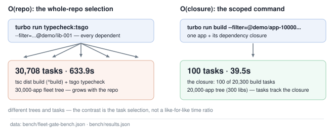
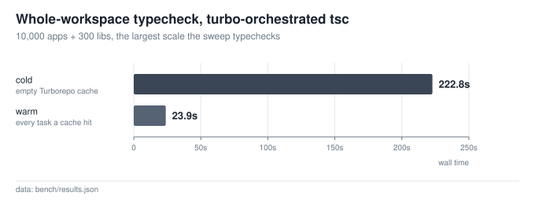
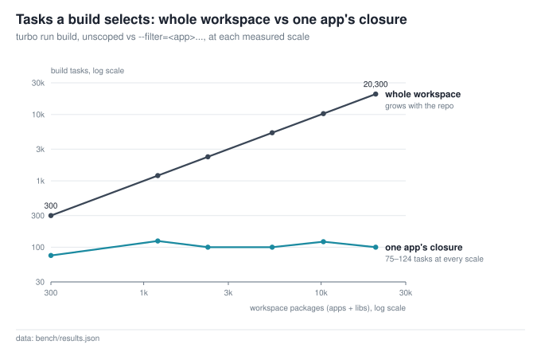
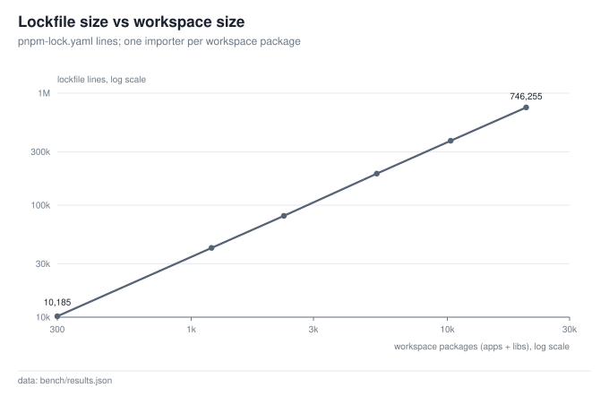
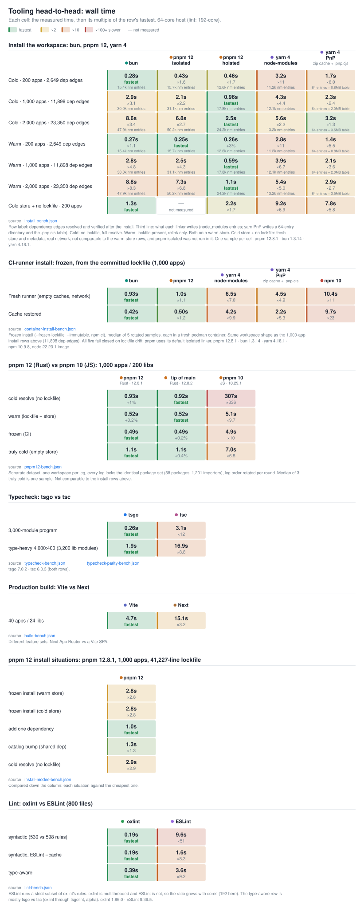
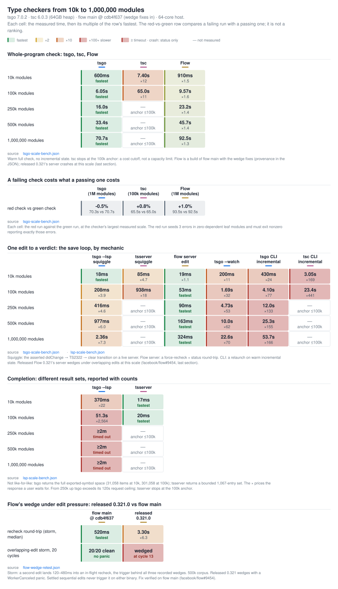

# Next.js Monorepo Scale Lab

A benchmark rig for a pnpm + Turborepo workspace of N Next.js apps and M shared libraries in a layered dependency graph. It is measured to 20,000 apps / 300 libs, the whole-workspace tsc typecheck to 10,000 apps, and the test-execution axis to 1,000 apps / 200 libs.

Whole-workspace operations (install, typecheck, warm `turbo run`, `turbo prune`'s graph load) scale with package count. A focused build (`turbo run --filter=<app>...`) executes one app's dependency closure: 75–124 packages at every measured scale, 100 of 20,300 at the top. Its task count tracks the closure, not the app count, but its wall time still grows ×4.8 across 100× apps (8.3s → 39.5s) because every turbo invocation loads the whole graph ([Results](#results-scaling-behavior)).



[High-resolution PNG](bench/charts/fig-orepo-oclosure.png)

**Figure 1.** A command whose selection is the whole repo — here the fleet gate, a filter on the foundation lib that selects every dependent — runs a task count that tracks repo size; a command filtered to one app selects that app's dependency closure, so its task count tracks that closure. The two sides are different trees on different machines (the 64-core fleet-gate record, the 192-core scaling record); the filtered command's wall time also carries a per-invocation graph load that grows with the repo ([Results](#results-scaling-behavior)).

Focus applies at three layers (install, task, artifact; [OPTIMIZATIONS.md §0](OPTIMIZATIONS.md#0-the-mental-model-three-layers-of-focus)). Measured by `scripts/measure.mjs` → [`bench/results.json`](bench/results.json).

## The Workspace Under Test

The workspace-scaling numbers in these docs come from one generated workspace shape, scaled by `APPS`/`LIBS`:

- **N Next.js apps** (`apps/app-*`): App Router, one layout + one page each. They are deliberately tiny, so app *count* is the variable under test, not app size.
- **M shared TypeScript libs** (`packages/lib-*`): each holds 16 generated modules re-exported through `src/index.ts`, and builds to `dist/` with tsc (`dependsOn: ["^build"]`).
- **A layered lib graph**: libs split into 6 layers; each lib imports up to 3 libs from the layer directly below it, and layer-0 libs import nothing. The graph is a DAG: closure depth is bounded by the layer count, and closures overlap heavily (many features share the same low-layer libs).
- **Each app imports 4 libs** spread across the lib range; with transitive deps an app's closure is 75–124 packages at the measured scales.
- **An optional universal foundation tier** (`--universal K`): libs 1..K become pure sinks imported by every app and every other lib (the `@acme/core` everyone imports). It is off in the scaling table below; the blast-radius benches (lib-rev, optimal-gate, test-axis, the remote-cache partial-invalidation rung) turn it on.
- **Internal deps** are `workspace:*` links; one pnpm catalog pins the Next/React/TS versions (`--versioned` switches to `workspace:^x.y.z`, see [WORKSPACE-VS-SEMVER.md](WORKSPACE-VS-SEMVER.md)).
- **A measured production shape** (`--preset fleet`): the skewed graph of a real fleet: 30,000 ~30-file apps over 460 libs, an apps-only universal tier, a semi-universal popular tier, 40% sink libs with deep narrow chains, variable fanout (median 14). Shape targets vs the generated tree are in [`bench/fleet-shape.json`](bench/fleet-shape.json); the model, divergences, and how to run it are in [FLEET.md](FLEET.md).

At 100 libs / 6 layers the shape is:

```
apps     app-001 … app-N            each app imports 4 libs, from any layer
           │
           ▼
libs     layer 5   lib-086 … lib-100  ─┐
         layer 4   lib-069 … lib-085   │  each lib imports ≤3 libs
         layer 3   lib-052 … lib-068   │  from the layer directly
         layer 2   lib-035 … lib-051   │  below it
         layer 1   lib-018 … lib-034   │
         layer 0   lib-001 … lib-017  ─┘  imports nothing (sinks)

         --universal K:  libs 1..K imported by every app and every other lib
```

A few benches measure a different corpus and say so where they report: the million-module checker sweeps (one program, not a workspace), the lint corpus, the type-parity scaffold, and the real-app vet.

### Quick start

```bash
# 1. generate a workspace (start at 200–2,000 apps)
pnpm install
pnpm gen -- --apps 200 --libs 100 --modules 16 --clean
pnpm install

# 2. one app's closure vs the whole workspace
turbo run build --filter=@demo/app-00100...   # focus build (one app's closure)
turbo run typecheck                            # whole-workspace typecheck
turbo prune @demo/app-00100 --docker           # minimal deploy subtree
```

`generate.mjs` flags (defaults): `--apps` 50, `--libs` 50, `--modules` 16, `--app-deps` 4, `--lib-deps` 3, `--layers` 6.

## Results: Scaling Behavior

Measured on a 192-core c8g.48xlarge (arm64): Node 22, pnpm 12.8.1 (each row's `versions.pnpm`), Turbo 2.9.18, TypeScript 6.0.3 for the per-package `tsc` tasks. `bench/results.json` carries no machine fields. A deliberate 12-thread nice-19 CPU keep-warm ran on the box during every bench of the 192-core `results` / `axis-bench` / `ci-cache-bench` / `ci-cache-network-bench` / `vite-task-bench` records; the three that capture load show a pre-run 1-minute load average of 13.5–25.8. The sweep has six scale points, 200 → 20,000 apps (100× apps, ~68× packages). The tsc, prune, and focus columns come from `scripts/measure.mjs` → `bench/results.json`; the `tsgo whole` column from `scripts/tsgo-scale-table-bench.mjs` → `bench/tsgo-scale-table.json` (same generator shape, also a 192-core c8g.48xlarge, typescript 7.0.2).

| apps (libs) | tsc cold¹ | tsc warm¹ | tsgo whole² | focus build³ | prune | build tasks | focus closure |
|---|---|---|---|---|---|---|---|
| 200 (100) | 8.4s | 1.0s | 0.33s | 8.3s | 0.5s | 300 | 75 |
| 1,000 (200) | 25.2s | 3.8s | 0.68s | 10.8s | 1.6s | 1,200 | 124 |
| 2,000 (300) | 46.6s | 5.2s | 1.01s | 11.9s | 1.9s | 2,300 | 100 |
| 5,000 (300) | 107.0s | 11.3s | — | 15.4s | 4.4s | 5,300 | 100 |
| 10,000 (300) | 222.8s | 23.9s | — | 22.2s | 11.8s | 10,300 | 121 |
| 20,000 (300) | — | — | — | 39.5s | 25.0s | 20,300 | 100 |

¹ `turbo run typecheck`: turbo-orchestrated tsc (a `tsc --noEmit` per package behind a tsc `^build`), cold then warm-cache hit. Not run at 20,000 apps (`scripts/sweep.mjs` omits the phase at its top scale).
² `tsgo whole`, the recommended checker: one `tsgo --noEmit` over the whole workspace from source (`@demo/*`→`packages/*/src`), one process with no dist build, median of 3, peak RSS 143→798 MB across its four points (`bench/tsgo-scale-table.json`). Its points are 200 / 1,000 / 2,000 / 4,000 apps; the fourth (1.47s) is a scale the tsc sweep does not run, and it has no point at 5,000 apps or above. tsgo keeps no incremental cache, so this cold number is its steady state. The per-package turbo+tsgo path is priced in [OPTIMAL-STACK.md](OPTIMAL-STACK.md).
³ `turbo run build --filter=<one app>...` (app + library closure). Generated source is made visible to Turbo for the run, so warm and graph-load numbers reflect real per-package hashing. Install is measured separately in [TOOLING.md](TOOLING.md#install-bun-vs-pnpm-vs-yarn-4).

Scaling factor, 200 → 10,000 apps (50× apps, 34× packages), the range every tsc column covers; the 20,000-app factor is added where the phase ran:

| operation | factor | class |
|---|---|---|
| tsc cold | ×26.4 | O(repo); 20–22ms per package from 1,200 packages up |
| tsc warm | ×24.4 | O(repo); Turbo hashes every package on a full hit |
| tsgo whole | ×4.4 (200 → 4,000 apps) | O(repo), sub-linear: program size grew ×7.4 and startup amortizes |
| prune | ×21.6 (×45.6 to 20,000 apps) | O(repo); reads the whole graph |
| focus build | ×2.7 (×4.8 to 20,000 apps) | O(closure) work (the closure stays 75–124 packages) plus an O(repo) graph load per invocation |

The focused build's work stays one closure, but its wall time carries a repo-sized term. At the three scales where the closure is 100 packages (2,000 / 5,000 / 20,000 apps), the focused build takes 11.9s / 15.4s / 39.5s and `turbo prune` of the matching 101-package subtree takes 1.9s / 4.4s / 25.0s. The two move together (+27.6s and +23.1s from 2,000 to 20,000 apps) because both load the whole graph before selecting a subset ([LIMITS.md](LIMITS.md), item 2).

The whole-program gate is cheap on the recommended checker: tsgo checks all 2,000 apps from source in **1.01s**, 46× faster than the turbo-orchestrated tsc column cold (which also builds each lib's dist) and 5.2× faster than its warm cache hit. At 20,000 apps the whole-workspace tsc typecheck is not run; extrapolating the 10,000-app per-package rates (21.6ms cold, 2.3ms on a full cache hit) gives ~7 minutes cold and ~47s warm on this box.

Scope with `--filter=<app>...` / `--affected` (an unscoped `turbo run` enumerates the whole graph even on cache hits); at 20,000 apps the graph-load term above argues for sharding. What stays irreducibly O(repo) is in [LIMITS.md](LIMITS.md).

### Charts




### The 64-Core Machine

The 64-core records listed here ran on a dedicated c7gd.metal with no other user or workload on it: a 64-core Graviton3 (Neoverse-V1) with 125.5 GiB RAM (135 GB as `bench/env.json` counts it) and two local NVMe disks as a btrfs RAID0 at `/mnt/fcvm-btrfs`. The root volume is a 30 GB gp3 EBS volume (ext4) at its default provisioning of 3,000 IOPS and 125 MiB/s; podman's storage root is on the btrfs RAID0 (`/mnt/fcvm-btrfs/containers/storage`, overlay driver). Host toolchain: node 22.23.3, pnpm 12.8.1, bun 1.3.14, yarn 4.18.1, typescript 7.0.2 (the native compiler) with typescript 6.0.3 as the oracle; `bench/env.json` is this box's capture (CPU model, cores, memory, kernel, tool versions). Before each queued bench the queue ran a 45-second all-core burst, waited for the 1-minute load average to fall below 1.5, and then started the bench. Records that capture pre-run load show 1.2–1.4, the decaying average from that burst; `fs-iops-bench` records 0.96. No record carries the instance type, the root volume's provisioning, podman's storage location or this protocol; a record carries its core count, tool versions, and in places memory or filesystem fields, where its bench writes them.

- install family: `install-bench`, `install-modes-bench`, `lockfile-bench`, `focus-install-bench`, `lockfile-merge-bench`, `pnpm12-bench`, `container-install-bench`, `perf-matrix`
- filesystem and device: `fs-bench`, `fs-iops-bench`
- checkers, builds, tests: `typecheck-bench`, `typecheck-parity-bench`, `tsgo-scale-bench`, `lsp-scale-bench`, `tsgo-pnp-bench`, `real-app-bench`, `rspack-turbopack-speed-bench`, `rspack-pnp-bench`, `pnp-compat-bench`, `vite-plus-tools-bench`, `build-bench`, `turbopack-bench`, `test-axis-bench`
- fleet: `fleet-gate-bench`, `sliced-gate-bench`, `fleet-flow-bench` (their `.pbox.json` companions are the 192-core runs), `yarn-fleet-bench`

The 64-core records not listed ran on a shared dev box of the same instance type, with other users' processes running. Four record tool behavior (exit codes, error codes, lockfile and manifest contents) and no timing: `wave-rollout-bench` (its install-speed text is derived from the two install records above), `bun-safety-bench`, `yarn-rollout-bench` and `decl-emit-caveat`. `fleet-shape` records graph metrics of the generated tree. `flow-wedge-retest` records a crash reproduction and the recheck times of the two Flow builds it compares.

## Day-to-Day Developer Simulation

`scripts/dev-sim.mjs --devs 4 --apps 1000 --libs 200`: D developers, each owning two apps + one lib, in a 1,000-app / 200-lib workspace (1,200 packages):

| operation | cost |
|---|---|
| onboarding: build a feature area (apps + lib closure) | median 8.6s |
| typecheck-on-save: edit an app, typecheck it | median 2.6s |
| build-before-push: edit an app, build it + closure | median 5.0s |
| lib-edit: rebuild your lib + dependents (21 packages) | median 8.3s |
| independence: a teammate's unrelated edit | adds 0 rebuilds |
| edit foundation lib (`lib-003`, low layer) | 1,080 of 1,200 packages rebuild |
| edit high-layer lib (`lib-197`) | 21 packages rebuild |

The inner loop is O(closure). Editing a low-layer foundation lib rebuilds ~90% of packages, which is why foundation edits lean on CI `--affected`, and on the remote cache only for runners after the first. The optimization playbook is in [`OPTIMIZATIONS.md`](OPTIMIZATIONS.md).

## Artifacts

- One app [deployed to Vercel](https://nextjs-monorepo-scale-demo.vercel.app) (pruned subtree, cloud build; 22s wall; `bench/deploy.json`).
- Four packages published to AWS CodeArtifact for the diamond demo (`scripts/diamond-demo.sh`).

## Findings by Area

**When a shared workspace is worth it:** when apps share code and versions, not when they are independent. Decision table in [FEASIBILITY.md](FEASIBILITY.md).

### Tooling Head-to-Head

Fastest install depends on what is cached and on workspace size; tsgo runs ~8.8–12× faster than tsc. Regenerate with `node scripts/comparison-chart.mjs`.



> High-resolution PNG of the chart above: [`bench/charts/tool-comparison.png`](bench/charts/tool-comparison.png).

<!-- chart-data:tool-comparison -->
<details>
<summary>The numbers as tables (fastest in bold; readable on a phone)</summary>

Each cell: the measured time, then its multiple of the fastest in its row (in pnpm 12 install situations: the cheapest in its column). 64-core host (lint: 192-core).

**Install the workspace: bun, pnpm 12, yarn 4**

|  | bun | pnpm 12 isolated | pnpm 12 hoisted | yarn 4 node-modules | yarn 4 PnP (zip cache + .pnp.cjs) |
| --- | ---: | ---: | ---: | ---: | ---: |
| Cold · 200 apps (2,649 dep edges) | **0.28s**<br>15.4k nm entries | 0.43s (×1.6)<br>15.7k nm entries | 0.46s (×1.7)<br>12.6k nm entries | 3.2s (×11)<br>11.2k nm entries | 1.7s (×6.0)<br>64 entries + 0.8 MB |
| Cold · 1,000 apps (11,898 dep edges) | 2.9s (×3.1)<br>30.0k nm entries | 2.1s (×2.2)<br>31.1k nm entries | **0.96s**<br>17.8k nm entries | 4.3s (×4.4)<br>12.1k nm entries | 2.3s (×2.4)<br>64 entries + 2.0 MB |
| Cold · 2,000 apps (23,350 dep edges) | 8.6s (×3.4)<br>47.9k nm entries | 6.8s (×2.7)<br>50.2k nm entries | **2.5s**<br>24.2k nm entries | 5.6s (×2.2)<br>13.2k nm entries | 3.2s (×1.3)<br>64 entries + 3.5 MB |
| Warm · 200 apps (2,649 dep edges) | 0.27s (×1.1)<br>15.4k nm entries | **0.25s**<br>15.7k nm entries | 0.26s (+3%)<br>12.6k nm entries | 2.8s (×11)<br>11.2k nm entries | 1.4s (×5.5)<br>64 entries + 0.8 MB |
| Warm · 1,000 apps (11,898 dep edges) | 2.8s (×4.8)<br>30.0k nm entries | 2.5s (×4.3)<br>31.1k nm entries | **0.59s**<br>17.8k nm entries | 3.9s (×6.7)<br>12.1k nm entries | 2.1s (×3.6)<br>64 entries + 2.0 MB |
| Warm · 2,000 apps (23,350 dep edges) | 8.8s (×8.3)<br>47.9k nm entries | 7.3s (×6.8)<br>50.2k nm entries | **1.1s**<br>24.2k nm entries | 5.4s (×5.0)<br>13.2k nm entries | 2.9s (×2.7)<br>64 entries + 3.5 MB |
| Cold store, no lockfile · 200 apps (fresh store and metadata, network) | **1.3s** | — (not measured) | 2.2s (×1.7) | 9.2s (×6.9) | 7.8s (×5.8) |

[`bench/install-bench.json`](bench/install-bench.json). Under each row label: the dependency edges resolved and verified after the install. Under each time: what the linker writes (node_modules entries; yarn PnP writes a 64-entry directory and the .pnp.cjs table). Cold: no lockfile, full resolve. Warm: lockfile present, relink only. Both on a warm store. Cold store, no lockfile: fresh store and metadata, real network; not comparable to the warm-store rows, and pnpm-isolated was not run in it. One sample per cell. pnpm 12.8.1 · bun 1.3.14 · yarn 4.18.1.

**CI-runner install: frozen, from the committed lockfile (1,000 apps)**

|  | bun | pnpm 12 | yarn 4 node-modules | yarn 4 PnP (zip cache + .pnp.cjs) | npm 10 |
| --- | ---: | ---: | ---: | ---: | ---: |
| Fresh runner (empty caches, network) | **0.93s** | 1.0s (×1.1) | 6.5s (×7.0) | 4.5s (×4.9) | 10.4s (×11) |
| Cache restored | **0.42s** | 0.50s (×1.2) | 4.2s (×9.9) | 2.2s (×5.3) | 9.7s (×23) |

[`bench/container-install-bench.json`](bench/container-install-bench.json). Frozen install (--frozen-lockfile, --immutable, npm ci), median of 5 rotated samples, each in a fresh podman container. Same workspace shape as the 1,000-app install rows above (11,898 dep edges). All five fail closed on lockfile drift. pnpm uses its default isolated linker. pnpm 12.8.1 · bun 1.3.14 · yarn 4.18.1 · npm 10.9.8, node 22.23.1 image.

**pnpm 12 (Rust) vs pnpm 10 (JS): 1,000 apps / 200 libs**

|  | pnpm 12 (Rust · 12.8.1) | tip of main (Rust · 12.8.2) | pnpm 10 (JS · 10.29.1) |
| --- | ---: | ---: | ---: |
| cold resolve (no lockfile, warm store) | 0.93s (+1%) | **0.92s** | 307s (×336) |
| warm (lockfile + store, node_modules wiped) | 0.52s (+0.2%) | **0.52s** | 5.1s (×9.7) |
| frozen (--frozen-lockfile, the CI row) | **0.49s** | 0.49s (+0.2%) | 4.9s (×10) |
| truly cold (fresh store + network; frozen) | **1.1s** | 1.1s (+0.4%) | 7.0s (×6.5) |

[`bench/pnpm12-bench.json`](bench/pnpm12-bench.json). Separate dataset: one workspace per leg, every leg locks the identical package set (58 packages, 1,201 importers), leg order rotated per round. Median of 3; truly cold is one sample with the lockfile retained (store and network cost, no re-resolve). Not comparable to the install rows above.

**Typecheck: tsgo vs tsc**

|  | tsgo | tsc |
| --- | ---: | ---: |
| 3,000-module program | **0.26s** | 3.1s (×12) |
| type-heavy 4,000:400 (3,200 lib modules) | **1.9s** | 16.9s (×8.8) |

[`bench/typecheck-bench.json`](bench/typecheck-bench.json), [`bench/typecheck-parity-bench.json`](bench/typecheck-parity-bench.json). tsgo 7.0.2 · tsc 6.0.3 (both rows).

**Production build: Vite vs Next**

|  | Vite | Next |
| --- | ---: | ---: |
| 40 apps / 24 libs | **4.7s** | 15.1s (×3.2) |

[`bench/build-bench.json`](bench/build-bench.json). Different feature sets: Next App Router vs a Vite SPA.

**pnpm 12 install situations: pnpm 12.8.1, 1,000 apps, 41,227-line lockfile**

|  | pnpm 12 |
| --- | ---: |
| frozen install (warm store) | 2.8s (×2.8) |
| frozen install (cold store) | 2.8s (×2.8) |
| add one dependency | **1.0s** |
| catalog bump (shared dep) | 1.3s (×1.3) |
| cold resolve (no lockfile) | 2.9s (×2.9) |

[`bench/install-modes-bench.json`](bench/install-modes-bench.json). Compared down the column: each situation against the cheapest one.

**Lint: oxlint vs ESLint (800 files)**

|  | oxlint | ESLint |
| --- | ---: | ---: |
| syntactic (oxlint 598 · ESLint 530 rules) | **0.19s** | 9.6s (×51) |
| syntactic, ESLint --cache | **0.19s** | 1.6s (×8.3) |
| type-aware | **0.39s** | 3.6s (×9.2) |

[`bench/lint-bench.json`](bench/lint-bench.json). ESLint runs a strict subset of oxlint's rules. oxlint runs multithreaded and ESLint runs single-process here (no --concurrency), so the ratio grows with cores (192 here). The type-aware row is mostly tsgo vs tsc (oxlint through tsgolint, alpha). oxlint 1.86.0 · ESLint 9.39.5.

</details>
<!-- /chart-data:tool-comparison -->

The same heat-table style, for how tsgo, tsc, and Flow behave as one program grows to a million modules (analysis in [TYPECHECKERS.md](TYPECHECKERS.md)):



> High-resolution PNG of the chart above: [`bench/charts/checker-scale.png`](bench/charts/checker-scale.png). Regenerate with `make scale-chart`.

<!-- chart-data:checker-scale -->
<details>
<summary>The numbers as tables (fastest in bold; readable on a phone)</summary>

tsgo 7.0.2 · tsc 6.0.3 (64GB heap) · flow main @ cdb4f637 (wedge fixes in) · 64-core host. Each cell: the measured time, then its multiple of the row's fastest. The red-vs-green row compares a failing run with a passing one; it is not a ranking.

**Whole-program check: tsgo, tsc, Flow**

|  | tsgo | tsc | Flow |
| --- | ---: | ---: | ---: |
| 10k modules | **600ms** | 7.40s (×12) | 910ms (×1.5) |
| 100k modules | **6.05s** | 65.0s (×11) | 9.57s (×1.6) |
| 250k modules | **16.0s** | — (anchor ≤100k) | 23.2s (×1.4) |
| 500k modules | **33.4s** | — (anchor ≤100k) | 45.7s (×1.4) |
| 1,000,000 modules | **70.7s** | — (anchor ≤100k) | 92.5s (×1.3) |

[`bench/tsgo-scale-bench.json`](bench/tsgo-scale-bench.json). Warm full check, no incremental state. tsc stops at the 100k anchor: a cost cutoff, not a capacity limit. Flow is a build of flow main with the wedge fixes (provenance in the JSON); released 0.321's server crashes at this scale (last section).

**A failing check costs what a passing one costs**

|  | tsgo (1M modules) | tsc (100k modules) | Flow (1M modules) |
| --- | ---: | ---: | ---: |
| red check vs green check | -0.5% (70.3s vs 70.7s) | +0.8% (65.5s vs 65.0s) | +1.0% (93.5s vs 92.5s) |

[`bench/tsgo-scale-bench.json`](bench/tsgo-scale-bench.json). Each cell: the red run against the green run, at the checker's largest measured scale. The red run seeds 3 errors in zero-dependent leaf modules and must exit nonzero reporting exactly those errors.

**One edit to a verdict: the save loop, by mechanic**

|  | tsgo --lsp squiggle | tsserver squiggle | flow server edit | tsgo --watch | tsgo CLI incremental | tsc CLI incremental |
| --- | ---: | ---: | ---: | ---: | ---: | ---: |
| 10k modules | **18ms** | 85ms (×4.7) | 19ms (×1.1) | 200ms (×11) | 430ms (×24) | 3.05s (×169) |
| 100k modules | 208ms (×3.9) | 938ms (×18) | **53ms** | 1.69s (×32) | 4.10s (×77) | 23.4s (×441) |
| 250k modules | 416ms (×4.6) | — (anchor ≤100k) | **90ms** | 4.73s (×53) | 12.0s (×133) | — (anchor ≤100k) |
| 500k modules | 977ms (×6.0) | — (anchor ≤100k) | **163ms** | 10.0s (×62) | 25.3s (×155) | — (anchor ≤100k) |
| 1,000,000 modules | 2.36s (×7.3) | — (anchor ≤100k) | **324ms** | 22.6s (×70) | 53.7s (×166) | — (anchor ≤100k) |

[`bench/tsgo-scale-bench.json`](bench/tsgo-scale-bench.json), [`bench/lsp-scale-bench.json`](bench/lsp-scale-bench.json). Squiggle: the asserted didChange → TS2322 → clear transition on a live server. Flow server: a force-recheck + status round-trip. CLI: a relaunch on warm incremental state. Released Flow 0.321's server wedges under overlapping edits at this scale (facebook/flow#9454, last section).

**Completion: different result sets, reported with counts**

|  | tsgo --lsp | tsserver |
| --- | ---: | ---: |
| 10k modules | 370ms (×22) | **17ms** |
| 100k modules | 51.3s (×2,564) | **20ms** |
| 250k modules | ≥2m (timed out) | — (anchor ≤100k) |
| 500k modules | ≥2m (timed out) | — (anchor ≤100k) |
| 1,000,000 modules | ≥2m (timed out) | — (anchor ≤100k) |

[`bench/lsp-scale-bench.json`](bench/lsp-scale-bench.json). Not like-for-like: tsgo returns the full exported-symbol space (31,058 items at 10k, 301,058 at 100k); tsserver returns a bounded 1,067-entry set. The × prices the response a user waits for. From 250k up tsgo exceeds its 120s request ceiling; tsserver stops at the 100k anchor.

**Flow's wedge under edit pressure: released 0.321.0 vs flow main**

|  | flow main @ cdb4f637 | released 0.321.0 |
| --- | ---: | ---: |
| recheck round-trip (storm, median) | **520ms** | 3.30s (×6.3) |
| overlapping-edit storm, 20 cycles | 20/20 clean (no panic) | wedged (at cycle 13) |

[`bench/flow-wedge-retest.json`](bench/flow-wedge-retest.json). Storm: a second edit lands 120–480ms into an in-flight recheck, the trigger behind all three recorded wedges. 500k corpus. Released 0.321 wedges with a WorkerCanceled panic. Settled sequential edits never trigger it on either binary. Fix verified on flow main (facebook/flow#9454).

</details>
<!-- /chart-data:checker-scale -->

- **Install cost.** pnpm 12.8.1 (the Rust CLI) cold-installs in seconds (0.43s → 6.8s isolated, 0.46s → 2.5s hoisted, 200 → 2,000 apps), resolves 331× faster than pnpm 10's JS CLI (307.4s → 0.93s at 1,000:200), and installs a pnpm-10 lockfile frozen with its bytes unchanged. The bun-vs-pnpm cold order depends on scale: bun is ~1.6× faster at 200 apps (~1.7× truly-cold, 1.3s vs 2.2s), while **pnpm-hoisted is 3.1–3.4× faster than bun at the measured 1,000- and 2,000-app points** (pnpm-isolated by 1.3–1.4×), where bun's cold is the slowest of the five configurations at 2,000. These 64-core records ([the dedicated box](#the-64-core-machine)) stop at 2,000 apps; the 192-core scaling sweep (catalog workspace, no lockfile, warm store) installs in 0.6s → 3.9s from 200 to 5,000 apps, then 31.3s at 10,000 and 74.9s at 20,000. ([TOOLING.md](TOOLING.md#install-bun-vs-pnpm-vs-yarn-4), [pnpm 12](TOOLING.md#pnpm-12-the-rust-rewrite))
- **CI-runner install (frozen, containers).** At 1,000 apps, fresh runner / cache-restored: **bun 0.93s / 0.42s, pnpm 1.03s / 0.50s** (pnpm 12.8.1 isolated, +11% / +19%), yarn-PnP 4.5s / 2.2s, yarn-nm 6.5s / 4.2s, npm 10.4s / 9.7s. All five configurations fail closed on lockfile drift. ([TOOLING.md](TOOLING.md#the-ci-runner-install-frozen-in-a-fresh-container))
- **yarn as rollout driver + PnP boundary.** yarn 4 runs every rollout mechanic natively, including CI auto-immutable. Under PnP, tsc, turbo, and oxlint run; stock tsgo does not, and tsgo's native PnP resolver ([typescript-go#460](https://github.com/microsoft/typescript-go/issues/460)) is the green path. `next build` under PnP: on node 22.23.3 every builder crashes loading `next.config` before a bundler is chosen; on 22.22.0 webpack and rspack build and Turbopack fails to resolve `next/package.json`. ([ROLLOUT.md](ROLLOUT.md#yarn-as-a-driver), [TOOLING.md](TOOLING.md#yarn-pnp-toolchain-compatibility))
- **Vite Task (Vite+) vs Turborepo.** turbo wins whole-repo typecheck (8.4–10.7× cold, 3.2–4.1× warm) and the focused cold run at both scales. vp's focused warm run stays flat as the repo grows 3× (0.81s → 0.83s) and leads turbo's by 1.2× at 1,000:200; on the 1,200-task test run vp is 2.7× faster warm and turbo 2.5× faster cold. vp is correct on gitignored and cross-package edits with zero config but refuses to cache self-mutating tasks (`next build`, `vite build`). ([TOOLING.md](TOOLING.md#vite-vp-task-runner-and-tool-layer))
- **`node_modules` footprint and linker.** Under pnpm 12 the linker is a speed choice whose direction depends on the workload: on the decataloged install-bench trees hoisted is 2.2–2.7× faster cold than isolated at 1,000–2,000 apps, while on the 300:100 catalog workspace it is ~1.7× slower ([OPTIMIZATIONS.md §1.1](OPTIMIZATIONS.md#11-node-linker-mode)). `isolated` is 374,827 entries / 241,712 symlinks at 20,000 apps (`results.json`); PnP shrinks it to 64 unplugged entries + a 0.8–3.5 MB `.pnp.cjs`. ([TOOLING.md](TOOLING.md))
- **Lockfile.** Irreducibly O(repo): 10,185 → 746,255 lines (200 → 20,000 apps, 34–37 lines per package). A `catalog:` bump edits **0** app manifests (vs 25 pinned) but rewrites hundreds of lockfile lines; two concurrent bumps conflict (253 markers), and `pnpm install` auto-resolves them to 0. ([OPTIMIZATIONS.md §1.5](OPTIMIZATIONS.md#15-lockfile-churn-and-merge-conflicts), [LIMITS.md](LIMITS.md))
- **Type-checking.** Whole-repo turbo-orchestrated tsc is O(repo) ([Results](#results-scaling-behavior)). tsgo (GA as `typescript@7`'s native `tsc`) is ~12× faster than tsc 6 on the 3,000-module benchmark and a drop-in for modern configs. At a million modules tsgo checks in 70.7s at 53.7GB RSS. Flow completes the sweep at +31% of tsgo's time on a third of the memory, and its server answers one valid edit in **324ms at 1M** (flow-main build; released 0.321 crashes at scale), against 2.5s for tsgo's LSP, which covers the open file only. With codegen in front, relay-compiler generates 10k artifacts in ~2.9s; tsgo then checks in 0.91s and Flow in 1.7s. ([TYPECHECKERS.md](TYPECHECKERS.md))
- **Build.** On Next 16, Turbopack is the default bundler, so `next build` and `next build --turbopack` run the identical build. A Vite SPA builds ~3.2× faster with ~20× less output, but it is a different feature set: a client SPA, not Next's server rendering. ([OPTIMIZATIONS.md §3](OPTIMIZATIONS.md#3-nextjs-build-cost), [TOOLING.md](TOOLING.md))
- **One large app (Turbopack).** On one 2,071-route App Router app with 16,068 TypeScript files (the shape of [next.js#98043](https://github.com/vercel/next.js/issues/98043)), Turbopack's module graph phase takes <!--v:sc.base.16.graph-->9.62s<!--/v--> at 16 cores and <!--v:sc.base.96.graph-->15.62s<!--/v--> at 96. Two Turbopack v16.4.0 patches (a sharded scheduler queue; a topological visit order for two whole-graph fixed points) cut the phase to **<!--v:ab.15+22.ratio-->0.360<!--/v-->×** on a 24-core lane and the Turbopack compile to **<!--v:ab.15+22.guard-->0.713<!--/v-->×**, with the same output ([TURBOPACK-GRAPH.md](TURBOPACK-GRAPH.md)).
- **Turbopack's persistent cache against changed files.** A warm `next build` restored from an earlier build reads its cache one 4 KiB page at a time (`MADV_RANDOM` turns read-ahead off); dropping that advice (candidate 55) takes the unchanged monolith's warm compile from <!--v:cr.candidatesD.base.mmap.0.turbopack-->13.1s<!--/v--> to <!--v:cr.candidatesD.55-sst-mmap-normal-advice.mmap.0.turbopack-->4.7s<!--/v-->, same output. A new import still reruns the whole-app analyses: from 10 new imports, base's warm build is slower than a cold one ([TURBOPACK-GRAPH.md](TURBOPACK-GRAPH.md#the-persistent-cache-against-changed-files)).
- **Lint.** oxlint lints an 800-file corpus in **190ms** (full **598**-rule set); ESLint runs the **530**-rule subset in **9.6s** / **1.6s** cached, so oxlint is **50.5×** / **8.3×** faster. `oxlint --type-aware` flags `no-floating-promises` in **388ms** vs ESLint's **3.6s** (**9.2×**). ([TOOLING.md](TOOLING.md))
- **Test execution.** Whole-repo `turbo run test` is one task per package (400 at 300:100, 1,200 at 1,000:200; cold 3.7s → 12.3s, warm 1.8s → 4.7s). Scoping is O(closure): a focused closure is 124 of 1,200 tasks; a leaf-lib edit re-tests 21 vs a universal-foundation edit's 1,200 (~57× spread). ([LIMITS.md](LIMITS.md))
- **Focus / deploy.** `turbo prune` emits a complete subtree (0 of 15 packages missing) + a pruned lockfile (1,050 of 4,127 lines, pnpm 12.8.1) but omits root configs (`tsconfig.base.json`). ([OPTIMIZATIONS.md §4](OPTIMIZATIONS.md#4-ci-and-deploy))
- **Semver vs `workspace:`.** `workspace:` forces local linking; `pnpm publish` rewrites it to a real range. Proven on CodeArtifact: a diamond keeps both majors under the isolated linker, a root override collapses it, and per-app transitive divergence needs a separate workspace + lockfile. The rules for when two copies exist (workspace-vs-registry edges, range convergence) are in [§8](WORKSPACE-VS-SEMVER.md#8-when-two-copies-exist-and-when-they-converge). User stories in [STORIES.md](STORIES.md). ([WORKSPACE-VS-SEMVER.md](WORKSPACE-VS-SEMVER.md))
- **Whole-program gate (4k:400).** On bun + tsgo + oxlint + turbo, one tsgo program gates 4,000 apps in 1.59s and catches a breaking foundation signature as every app red (4,399 `TS2554`); its `declaration:false` setting misses a `.d.ts` portability error the build catches. ([OPTIMAL-STACK.md](OPTIMAL-STACK.md))
- **Developer inner loops.** Per-role O(closure) loops on the optimal stack (app dev, lib dev), fresh vs subsequent: typecheck, lint, focused gate all in seconds. Also run on real apps (vercel/commerce, shadcn/taxonomy). ([SUMMARY.md](SUMMARY.md), [OPTIMAL-STACK.md](OPTIMAL-STACK.md))
- **Core-lib rollout.** The lockfile is the determinism boundary: a frozen install makes the range form inert. bun drives the rollout natively, and pnpm 12 runs all five rollout mechanics. Advancing a universal lib is a republish fanout; breaking changes go expand→migrate→contract. ([ROLLOUT.md](ROLLOUT.md))
- **bun adoption safety.** Adoptable, with two gaps and one pnpm edge: bun's built-in allowlist runs registry `postinstall` scripts that pnpm 12 blocks and fails the install on, and bun has no fail-closed strict-peer knob where pnpm 12 has one; pnpm isolates phantom dependencies in single-package projects. The rest is parity. ([ROLLOUT.md](ROLLOUT.md#adoption-safety))
- **Remote cache (CI economics).** A shared Turborepo cache turns the O(repo) CI cold start into a restore of unchanged tasks' outputs (192-core box): typecheck **9.9s → 1.5s** (6.8×, 300:100) and **24.8s → 3.9s** (6.4×, 1,000:200), build **24.8s → 3.8s** (6.5×, 300:100). After a leaf-lib edit **486 of 500** tasks still restore; after a foundation-lib edit **0 of 500** do. Across a 10-runner fleet it amortizes ~4.2×. ([LIMITS.md](LIMITS.md#remote-cache-amortizing-the-orepo-cold-start))
- **Editor / language server.** Opening one app is O(closure): the server loads its closure (65 libs / 1,123 files), flat as the repo grows 8×. tsgo's native LSP opens it in **113ms vs tsserver's 1,563ms** (13.8×) with **309 vs 414MB** RSS; warm, both answer def/hover in ≤2ms. ([LIMITS.md](LIMITS.md#editor-and-language-server))
- **The fleet shape.** `--preset fleet` regenerates a measured production fleet (30,000 ~30-file apps / 460 libs, ~1.03M generated files) with all 15 recomputed graph metrics inside tolerance. On the 64-core box one tsgo program type-checks it from source in **58.1s** and turns all 30,000 apps red on a breaking foundation rev in **58.9s**; it does not get faster on 192 cores (66.6s). Sliced into K concurrent programs with a union-verified identical verdict, the check takes **10.3s** on 64 cores and **6.2s** on 192. `make typecheck-whole` packages the one-command gate. ([FLEET.md](FLEET.md))
- **Flow on the fleet shape.** On a Flow-dialect mirror of the fleet (876,440 files, a smaller ambient surface than the TS program; both checkers flag exactly 30,171 call sites on the breaking rev), Flow's batch check is 1.4× slower than tsgo (79.7s vs 58.1s) at **2.6× less memory**, and its resident server returns the full 30,000-apps-red verdict **incrementally in 14.9s**, a server-style verdict tsgo does not have. ([TYPECHECKERS.md](TYPECHECKERS.md#flow-on-the-fleet-shape))
- **yarn 4 at fleet scale.** PnP installs the 30,460-package workspace truly-cold in **41.2s** (one 62MB `.pnp.cjs`; the node-modules farm it replaces is 4.88M entries, 203.5s), and a native-PnP tsgo build runs the whole-program gate through it in **57.9s vs 57.4s for the same binary over node-modules**, one timed run per linker, 0.8% apart. Stock tsgo still fails PnP (30,000 × TS2503). ([TOOLING.md](TOOLING.md#yarn-pnp-toolchain-compatibility), `bench/yarn-fleet-bench.json`)
- **The ceiling.** What focus, cache, and `--affected` cannot remove at ~20,000 apps: the single lockfile, the per-command Turbo graph-load floor, foundation blast radius (~90% of packages), inode/disk pressure, language-server memory, git worktree cost, Vercel's per-project model. Past this, shard or move to a daemon + remote-execution build system. ([LIMITS.md](LIMITS.md))

Methodology and grounding: [GROUNDING.md](GROUNDING.md) maps each practice to its primary source; [REVIEW.md](REVIEW.md) is the quality pipeline every change runs through.

## License

MIT, see [LICENSE](LICENSE).
