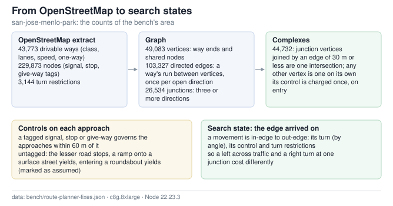
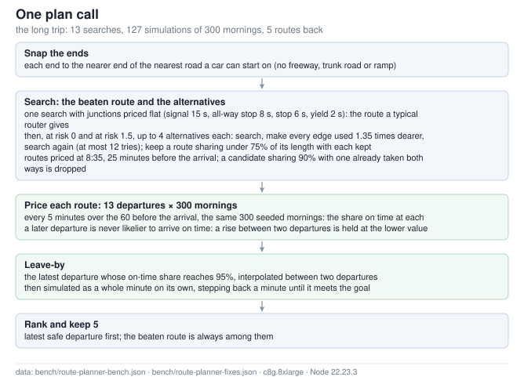
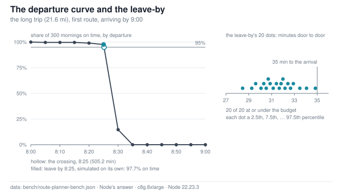
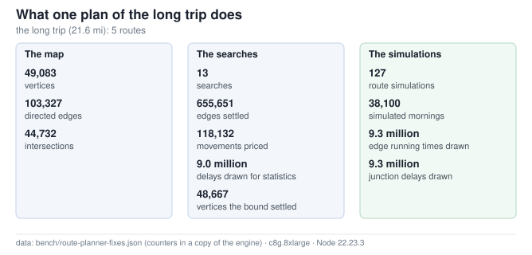
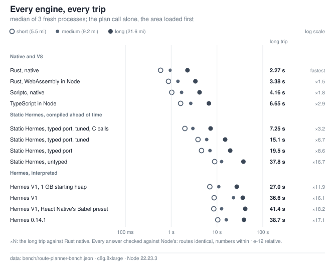
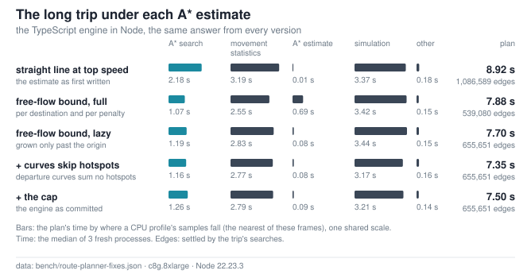
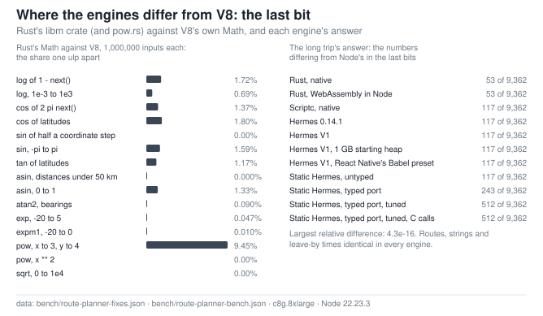

# One Workload, Twelve Engines: a Trip Planner

Compiled from Rust, the planner plans a 21.6-mile trip in **2.27 s**; the same TypeScript takes 6.65 s in Node (2.9 times as long), 4.16 s compiled ahead of time by Scriptc (1.8 times), and 27.0 s to 41.4 s in Hermes' interpreters. Static Hermes compiles the untyped program to 37.8 s, no faster than its interpreter; a hand-written typed port takes it to 19.5 s, and to 7.25 s once its bit operations and Math calls are direct C calls. Rust compiled to WebAssembly runs in Node in 3.38 s. Every engine returns Node's routes and leave-by times.

The workload is a trip planner's engine (`route-planner/`): for a trip and an arrive-by time it
finds candidate routes, simulates each one over 300 mornings at 13 departure times, and returns
each route's latest safe departure and its on-time curve. It is plain TypeScript with no
dependencies, no I/O and no clock, so the same source runs in Node, compiles ahead of time with
Scriptc and with Static Hermes, and is ported to Rust with the same arithmetic in the same order.
Every engine's answer is checked against Node's: the same routes, keys, strings and leave-by
times, and every number within 1e-12 relative.

## The Workload

The area is an OpenStreetMap extract of the San José–Menlo Park corridor (box 37.24..37.50,
-122.23..-121.86; [route-planner/data/README.md](route-planner/data/README.md)). The three trips
run between public landmarks and arrive by 9:00 (`route-planner/trips.json`):

| trip | from | to | first route |
|---|---|---|---|
| long | San José City Hall | Menlo Park station | 21.6 mi, 5 routes |
| medium | Sunnyvale station | Palo Alto station | 9.2 mi, 5 routes |
| short | Sunnyvale station | San Antonio station | 5.5 mi, 5 routes |

Each plan uses 300 simulated mornings, departures every 5 minutes over the hour before the
arrival, and a 95% on-time goal. Node, Hermes and the probes all time the same call, the one an
app makes: `call(handle, "plan", request)` (`route-planner/native/engine-lib.ts`), JSON in and
JSON out, after the area is loaded and its graph built.

## What the Algorithm Does

### The graph



[High-resolution PNG](bench/charts/fig-route-graph.png)

**Figure 1.** A vertex is a way's end or a node two ways share; each way's run between two
vertices is one directed edge per direction it is open. A junction has three or more physical
directions (a bend where a way is split is a vertex, not a junction). Junction vertices joined by
an edge of 30 m or less, such as a divided road's two carriageways, form one *complex*, whose
control is charged once, on entry. The search's state is the edge arrived on, so a movement is a
pair of edges and has its own turn, control and turn restrictions.

<!-- chart-data:fig-route-graph -->
<details>
<summary>The figure's numbers as a table</summary>

|  | count |
| --- | ---: |
| drivable ways | 43,773 |
| nodes | 229,873 |
| turn restrictions | 3,144 |
| vertices | 49,083 |
| directed edges | 103,327 |
| junctions (3+ directions) | 26,534 |
| complexes (an intersection, or a lone vertex) | 44,732 |

Fields: `bench/route-planner-fixes.json`: `astar.map.{ways,nodes,restrictions,vertices,edges,junctions,complexes}`.

</details>
<!-- /chart-data:fig-route-graph -->

- **Controls** (`graph.ts`). A signal, stop or give-way tag governs the approaches within 60 m
  of it, in the tagged direction or toward the nearer junction. An untagged approach to a
  junction where a signal or all-way stop is tagged takes that control; otherwise the lesser road
  stops, a ramp onto a surface street yields, a ramp onto a freeway merges with no control, and
  entering a roundabout yields. An inferred control is marked as assumed in the answer.
- **Restrictions.** OSM `no_*` and `only_*` turn restrictions with a node as their via are
  obeyed; an `only_*` onto a way the extract does not hold is dropped, not obeyed as a dead end.
  No movement turns back down the piece of road it came in on.

### Traffic

`traffic.ts` gives each edge a running time at a minute of the day:

- **Demand.** A road class's peak directional volume (3,600 vehicles an hour on a motorway down to
  45 on a residential street), scaled by its lanes, times a weekday demand profile: 6% of the
  peak at midnight, 100% from 7:55 to 8:15, interpolated linearly between 20 points.
- **Running time.** The BPR curve: free-flow time × (1 + α (volume / capacity)^β), with α 0.15,
  β 4 on arterials and α 0.83, β 5.5 on freeways, so a freeway near capacity slows and an arterial
  barely does (its delay is at the junctions).
- **One morning.** Each simulated morning draws one day factor, lognormal with σ 0.15, that
  multiplies every road's demand, and each edge's running time is multiplied by its own lognormal
  noise, σ 0.1.

### Intersection delay

`intersection.ts` draws one vehicle's delay for one movement:

- **Signal.** The cycle is 70 to 130 s by the busiest road's class; the major road's through
  movement gets 55% green, a side street 30%, a left turn a protected 12–14% phase. Arriving at a
  random point in the cycle (30% of the time, a major-road through driver is carried into the
  green by coordinated signals), it waits out the red and the queue that arrived in it, 2 s per
  car per lane. Near and over saturation the queue does not clear in one green: each missed cycle
  adds another red, and a demand over capacity is an overflow.
- **Stop and yield.** Gap acceptance (HCM): the movement's capacity against the conflicting
  flow, with critical headways of 6.2 to 7.1 s (longer across a four-lane road, shorter at a
  yield); the cars queued ahead (geometric, with a growing
  overflow queue over capacity) each clear in an exponential time; then the wait for a gap of the
  critical headway in a Poisson stream; plus 5 s to stop and start (1.5 s at a yield where the
  wait came to under a second).
- **All-way stop.** About 4 s per vehicle, taking turns with the other approaches.
- **Unprotected left from the major road.** A gap of 4.1 s in the oncoming flow.
- **Free and internal movements.** A turn costs 2.5 s (right), 3.5 s (left) or 12 s (U-turn), and
  a free turn 0.5 s more.

A stop, yield or all-way stop delay is capped at 15 minutes; a signal stops adding missed cycles once the wait passes four cycles.

### Movement statistics

The search does not draw delays: it reads each movement's mean and standard deviation for the
5-minute bucket it arrives in (`router.ts`, `MovementStats`). The first time a movement is
priced in a bucket, it draws 48 delays from a random stream seeded by the movement's own two
edges, each with its own day factor, at the bucket's middle minute. The same stream at every
hour means the differences between hours are the traffic's, not the dice's. The statistics are
cached for the life of the loaded area.

### Time-dependent A*

`shortestPath` is A* over edges. An edge's cost is its running time at the minute the car reaches
it, times the alternatives' penalty, plus the movement's mean delay, plus `risk` × the delay's
standard deviation; `destination`-only roads cost 120 s more unless the trip starts or ends on
one. The estimate is the free-flow seconds still to go, from one backward Dijkstra search from
the destination over free-flow times (no traffic, no waits, no turn rules): no route's cost is
less, so the estimate never overstates what remains, and on every trip measured it returns the
same routes as the straight-line estimate it replaced (Figure 6). The backward search grows lazily: it stops once it has passed the origin by twice the
origin's free-flow time and at least a minute; a vertex it has not reached gets the distance
searched so far. It is cached per destination (four kept) and resumed for a search from
farther away, and capped at four times the straight-line distance at 40 m/s plus ten minutes, for
an origin that cannot reach the destination at all.

### Alternatives



[High-resolution PNG](bench/charts/fig-route-plan.png)

**Figure 2.** The beaten route prices junctions flat, as a typical router does (signal 15 s,
all-way stop 8 s, stop 6 s, yield 2 s), with no traffic risk. The alternatives use the penalty
method at two risk levels, 0 (the expected time) and 1.5 (avoiding junctions whose bad days are
bad): after each search every edge the route used costs 1.35 times more, and a route is kept if
it shares under 75% of its length with every route kept so far, both ways. Up to 4 a risk level,
in at most 12 searches. A candidate that shares 90% of its length with one already taken, both
ways, is dropped. Every route is searched at 25 minutes before the arrival.

<!-- chart-data:fig-route-plan -->
<details>
<summary>The figure's numbers as a table</summary>

| the long trip's plan | count |
| --- | ---: |
| searches | 13 |
| simulations | 127 |
| mornings per simulation | 300 |
| departures per route | 13 |
| routes back | 5 |

Fields: `bench/route-planner-fixes.json`: `astar.results.long.now.counters.{searches,simulations}`. `bench/route-planner-bench.json`: `workload.request.{runs,windowMinutes,stepMinutes,goal.confidence}`, the long trip's `routes`, `arriveByMinute` and `curve`.

</details>
<!-- /chart-data:fig-route-plan -->

### The departure curve and the leave-by



[High-resolution PNG](bench/charts/fig-route-curve.png)

**Figure 3.** Each route is simulated at 13 departures, every 5 minutes over the hour before the
arrival, each over 300 mornings from the same seed, so most of a step between departures is the
traffic and not the dice (the draws drift apart where queues and gaps draw more numbers on a busier
minute). The engine treats leaving later as never making arriving by a fixed time likelier, so a
rise between two departures is taken as sampling noise and held at the lower value. The
leave-by is where the curve crosses the goal, interpolated between two departures; that minute is
then simulated on its own and, if it falls short, stepped back a whole minute at a time to one
that meets the goal. The 20 dots are that simulation's 2.5th, 7.5th, … 97.5th percentiles of
door-to-door time: one per weekday of a month.

<!-- chart-data:fig-route-curve -->
<details>
<summary>The figure's numbers as a table</summary>

Leave by 8:25 (the crossing at 505.16 min, 8:25); at 8:25 on its own: 97.7% on time. The 20 dots (minutes door to door): 28.5, 29.3, 29.6, 30.1, 30.3, 30.5, 30.7, 30.9, 31.1, 31.4, 31.7, 31.8, 32.0, 32.2, 32.4, 32.7, 32.9, 33.5, 34.1, 34.8.

| departure | on time | p10 | p50 | p90 |
| --- | ---: | ---: | ---: | ---: |
| 8:00 | 100.0% | 30.1 min | 32.6 min | 35.6 min |
| 8:05 | 99.7% | 29.7 min | 32.1 min | 34.9 min |
| 8:10 | 99.7% | 30.0 min | 32.1 min | 34.6 min |
| 8:15 | 99.7% | 29.8 min | 31.7 min | 34.3 min |
| 8:20 | 99.0% | 29.6 min | 31.7 min | 34.2 min |
| 8:25 | 97.7% | 29.5 min | 31.6 min | 33.7 min |
| 8:30 | 14.7% | 29.6 min | 31.6 min | 34.1 min |
| 8:35 | 0.0% | 29.6 min | 31.6 min | 33.8 min |
| 8:40 | 0.0% | 29.3 min | 31.6 min | 33.7 min |
| 8:45 | 0.0% | 29.3 min | 31.4 min | 33.5 min |
| 8:50 | 0.0% | 28.8 min | 31.3 min | 33.5 min |
| 8:55 | 0.0% | 29.1 min | 31.1 min | 33.1 min |
| 9:00 | 0.0% | 29.0 min | 31.0 min | 32.9 min |

Fields: `bench/route-planner-bench.json`, the long trip: `curve[].{departMinute,onTime,p10Sec,p50Sec,p90Sec}`, `leaveBy[0]`, `atLeaveBy.{departMinute,onTime,dots}`, `arriveByMinute`; `workload.request.{runs,goal.confidence}`.

</details>
<!-- /chart-data:fig-route-curve -->

### The workload's size



[High-resolution PNG](bench/charts/fig-route-workload.png)

**Figure 4.** The searches touch a share of the map and price each movement they reach once per
5-minute bucket; the simulations then draw a running time for every edge and a delay for every
junction of every route, at every departure, on every morning. The counts come from a copy of
the engine with counters added, whose answer is the same as the timed engine's.

<!-- chart-data:fig-route-workload -->
<details>
<summary>The figure's numbers as a table</summary>

|  |  | count |
| --- | --- | ---: |
| The map | vertices | 49,083 |
| The map | directed edges | 103,327 |
| The map | complexes | 44,732 |
| The searches | searches | 13 |
| The searches | edges settled | 655,651 |
| The searches | movements priced | 118,132 |
| The searches | delays drawn for statistics | 8,964,288 |
| The searches | vertices the bound settled | 48,667 |
| The simulations | route simulations | 127 |
| The simulations | simulated mornings | 38,100 |
| The simulations | edge running times drawn | 9,293,100 |
| The simulations | junction delays drawn | 9,255,000 |

Fields: `bench/route-planner-fixes.json`: `astar.map.{vertices,edges,complexes}`; `astar.results.long.now.counters.{searches,settled,buckets,boundSettled,simulations,mornings,edgeDraws,crossings}` (counted in a copy of the engine with counters added, which change no arithmetic: its answer's hash is the timed copy's) and `movementPairs`. Delays drawn = buckets × 48.

</details>
<!-- /chart-data:fig-route-workload -->

On the long trip the 13 searches settle 655,651 edges in all, 6.3 times the map's 103,327, and price 118,132 movements in 186,756 buckets: 8,964,288 delays drawn for statistics. The 127 simulations draw 9,293,100 running times and 9,255,000 junction delays. Of the plan's JavaScript samples in Node's CPU profile (garbage collection not counted), the simulations take 43%, the movement statistics 37% and the rest of the searches 17% (Figure 6).

## The Engines

| engine | what runs |
|---|---|
| TypeScript in Node | `route-planner/engine/src` as written, Node 22's type stripping |
| Rust, native | `route-planner/engine-rs`, a static library with the C interface of `native/profile.json`, linked into `native/probe.c` |
| Rust, WebAssembly in Node | the same crate for `wasm32-unknown-unknown`, through `wasm-bindgen` |
| Scriptc, native | the TypeScript compiled ahead of time by Scriptc 0.4.0 into a static library with the same C interface |
| Hermes 0.14.1 | the plan program bundled by esbuild, then through React Native's Babel preset (0.14.1 does not parse classes), compiled to bytecode by `hermesc -O` |
| Hermes V1 | the esbuild bundle (ES2017), `hermesc -O`; also with a 1 GB starting heap (`-gc-init-heap=1G`), and on the Babel output |
| Static Hermes, untyped | the esbuild bundle compiled to native code by V1's `shermes -O` |
| Static Hermes, typed port | `route-planner/hermes/typed/port.js`: the plan path rewritten in the typed subset `shermes -typed` compiles; `tuned.js` with the hot path's maps, allocations and builtins replaced; and `tuned.js` with its bitwise operators and Math calls as direct C calls (`ffi.py`) |

`scripts/route-planner/build.mjs` builds them all (Hermes from source at its release tags),
`bench.mjs` times them, `fixes.mjs` measures each fix below, and `scriptc-check.mjs` records what
Scriptc says of the engine before and after its rewrites.

## Results



[High-resolution PNG](bench/charts/fig-route-engines.png)

**Figure 5.** Each engine runs each trip in a fresh process with a freshly loaded area, three
rounds with Node first in each. In the record the other engines ran in one order in the first two
rounds and shifted by one in the third; `bench.mjs` now shifts them by one every round. The time
is the plan call alone, as the engine measures it. The ahead-of-time compilers keep the TypeScript's semantics and differ in what
they can assume: Rust has fixed-layout structs, typed arrays and no garbage collector; Scriptc
compiles from the TypeScript checker's types with a runtime for dynamic parts; Static Hermes
untyped compiles every operation for any JavaScript value, and typed only where its
typed subset reaches.

<!-- chart-data:fig-route-engines -->
<details>
<summary>The figure's numbers as a table</summary>

| engine | short | medium | long | long vs Rust native |
| --- | ---: | ---: | ---: | ---: |
| Rust, native | 0.59 s | 0.96 s | 2.27 s | fastest |
| Rust, WebAssembly in Node | 0.88 s | 1.41 s | 3.38 s | ×1.5 |
| Scriptc, native | 1.03 s | 1.69 s | 4.16 s | ×1.8 |
| TypeScript in Node | 1.61 s | 2.68 s | 6.65 s | ×2.9 |
| Static Hermes, typed port, tuned, C calls | 2.00 s | 2.98 s | 7.25 s | ×3.2 |
| Static Hermes, typed port, tuned | 3.85 s | 5.97 s | 15.1 s | ×6.7 |
| Static Hermes, typed port | 4.60 s | 7.04 s | 19.5 s | ×8.6 |
| Static Hermes, untyped | 8.90 s | 12.6 s | 37.8 s | ×16.7 |
| Hermes V1, 1 GB starting heap | 6.97 s | 10.9 s | 27.0 s | ×11.9 |
| Hermes V1 | 8.68 s | 22.9 s | 36.6 s | ×16.1 |
| Hermes V1, React Native's Babel preset | 8.52 s | 12.6 s | 41.4 s | ×18.2 |
| Hermes 0.14.1 | 10.4 s | 15.9 s | 38.7 s | ×17.1 |

Fields: `bench/route-planner-bench.json`: `results.<trip>.<engine>.medianMs`, `engines[].label`, `rounds`, `parityBound`, `workload.trips[].miles`.

</details>
<!-- /chart-data:fig-route-engines -->

- **Rust native is the fastest on every trip**: 0.59 s, 0.96 s and 2.27 s. On the long trip its WebAssembly build in Node takes 1.5 times as long, Scriptc's native code 1.8 times, and the TypeScript in Node 2.9 times.
- **Scriptc** compiles the engine (with the rewrites below) to 4.16 s, 1.6 times as fast as Node's JIT on the same source.
- **Hermes' interpreters** take 27.0 s (V1 with a 1 GB starting heap) to 41.4 s (V1 on the Babel output) on the long trip, 11.9 to 18.2 times Rust native's time.
- **Static Hermes** compiled untyped is 37.8 s, no faster than V1 interpreting the same bundle (36.6 s). The typed port takes 19.5 s, the tuned port 15.1 s, and the tuned port with C calls 7.25 s, 1.1 times Node's time.
- On the shorter trips the order among the Hermes engines changes: on the medium trip Hermes 0.14.1 (15.9 s) is faster than V1 with its default heap (22.9 s), and slower than V1 on the Babel output (12.6 s). Node takes 2.7 times Rust native's time on the short trip, 2.9 on the long.

## What Each Fix Bought

### The A* estimate



[High-resolution PNG](bench/charts/fig-route-astar.png)

**Figure 6.** The A* estimate was first straight-line distance at the fastest free speed in the
graph. On city streets that bound is loose, and each movement the search reaches costs 48 sampled
delays the first time. The free-flow bound replaced it, first as a backward search to the whole
map for each destination and, for alternatives, a new one for every penalized search; review
found that a short trip in a big area then searched the whole map many times a plan, and the
bound was made to grow lazily from the destination and be reused across penalties. A second
review finding: an origin that cannot reach the destination never stops the lazy search, so it
is capped. Departure
curves also stopped summing each intersection's waits, which only the leave-by's simulation
reads. Every version gives the same answer.

<!-- chart-data:fig-route-astar -->
<details>
<summary>The figure's numbers as a table</summary>

| estimate | plan | A* search | movement statistics | A* estimate | simulation | other | edges settled | movements priced |
| --- | ---: | ---: | ---: | ---: | ---: | ---: | ---: | ---: |
| straight line at top speed (the estimate as first written) | 8.92 s | 24.4% | 35.8% | 0.1% | 37.8% | 2.0% | 1,086,589 | 123,864 |
| free-flow bound, full (per destination and per penalty) | 7.88 s | 13.6% | 32.4% | 8.8% | 43.4% | 1.9% | 539,080 | 115,856 |
| free-flow bound, lazy (grown only past the origin) | 7.70 s | 15.4% | 36.8% | 1.1% | 44.7% | 2.0% | 655,651 | 118,132 |
| + curves skip hotspots (departure curves sum no hotspots) | 7.35 s | 15.8% | 37.7% | 1.1% | 43.2% | 2.2% | 655,651 | 118,132 |
| + the cap (the engine as committed) | 7.50 s | 16.9% | 37.3% | 1.1% | 42.8% | 1.9% | 655,651 | 118,132 |

Fields: `bench/route-planner-fixes.json`: `astar.results.long.<variant>.{medianMs,answerSha256,counters.settled,movementPairs}`, `astar.profiles.<variant>.shares`, `runs`; the long trip's `answerSha256` in `bench/route-planner-bench.json`.

</details>
<!-- /chart-data:fig-route-astar -->

- **The free-flow bound.** On the long trip the straight-line estimate settles 1,086,589 edges and prices 123,864 movements; the free-flow bound, grown lazily, settles 655,651 and prices 118,132, and the plan goes from 8.92 s to 7.70 s. On the short trip, 194,313 edges against 102,918. Every version returns the same answer: the bound only changes the order the search visits edges in. The full bound settles fewest edges (539,080) because each penalized search got a bound with its penalties in it, at the price of a full backward search each time.
- **Short trips (review finding).** Searched to exhaustion per destination and again for every penalized search, the bound settles 438,003 vertices on the short trip, 8.9 times the map's 49,083, and the plan takes 2.21 s, slower than the straight-line estimate's 2.11 s. Grown lazily and reused across penalties it settles 33,262, and the plan takes 1.86 s.
- **Unreachable origins (review finding).** From a stub of road that cannot reach its destination (`fixes.mjs`'s `UNREACHABLE`), the lazy search never passes the origin and settles every vertex that reaches the destination, 48,667; capped, 26,413, and the plan (three searches, no route) takes 107 ms against 135 ms.
- **The hotspot skip.** Departure curves read only each simulation's times; summing every intersection's waits at every departure cost the long trip 7.70 s against 7.35 s without.
- Each time is the median of 3 fresh processes in this harness, which loads the area differently from the bench (Node's long trip takes 7.50 s here, 6.65 s in the bench); two versions doing the same work on the medium trip (skip and now: the cap does not bind there) differ by 7%.

### Scriptc: what it would not compile, and the WeakMap

Scriptc compiles from the TypeScript checker's types, and a construct it has no lowering for is an error. On the engine as it stood before its rewrites (`scripts/route-planner/variants.mjs`'s `PRE_SCRIPTC`, the current form against the old), Scriptc 0.4.0's `build --lib` fails with 12 errors, and its coverage report compiles 1,037 of 1,049 statements statically and lists the same 12 under "in unreached code (never lowered — cannot fail a build)", so `coverage --fail-on blockers` exits 0 on that engine:

- 5 × `SC1090`: indexing with non-number keys
- 2 × `SC2020`: 'Float64Array<…>.reduce' is part of the standard library types but has no scriptc lowering yet
- 1 × `SC1090`: assignment to non-variables
- 1 × `SC2002`: record shapes must match exactly or width-coerce: expected 'number', got '{ control: null | string; controlDirection: null | string; id: number; lat: number; lon: number }'
- 1 × `SC2002`: record shapes must match exactly or width-coerce: expected 'number', got '{ fromWay: number; kind: string; toWay: number; viaNode: number }'
- 1 × `SC2002`: record shapes must match exactly or width-coerce: expected '{ control: null | string; controlDirection: null | string; id: number; lat: number; lon: number }[]', got 'number[]'
- 1 × `SC2020`: 'Math.max' is part of the standard library types but has no scriptc lowering yet

Each was rewritten with the same arithmetic in the same order: `sum()` loops for `Float64Array.reduce`, the leave-by floor as a loop instead of `Math.max` over a spread plus one argument, counting loops instead of `for…of` where the key indexes a typed array, `fill` as a statement, typed node and restriction lists in `fromPack`, and the hotspot sums assigned through a local. After them all 1,058 statements compile statically and the build succeeds (`bench/route-planner-scriptc.json`).

**The WeakMap.** The traffic terms of each edge (its base volume, free-flow time, capacity and BPR parameters, computed once per edge and calibration) were kept in a `WeakMap` keyed by the edge objects. Scriptc builds that, but on the short trip the native plan had not finished after 10 minutes; with the terms kept on the edge (`Edge.terms`) it takes 1.09 s. In Node the same change takes the short trip from 1.93 s to 1.74 s.

### Rust: the determinism contract, `pow` and the sort

The port's contract is the TypeScript's results, bit for bit where the arithmetic allows: the same operations in the same order, no fused multiply-add, floats summed in the same order, the heap breaking ties as `router.ts`'s does, the A* bound grown and evicted as the TypeScript's is (it steers the search, so it decides ties), insertion-ordered maps wherever the TypeScript iterates a `Map`, stable sorts with the same comparators, and JavaScript's `Math.round`, `toFixed` and number spellings (`jsmath.rs`, `jsnum.rs`). Every transcendental goes through the `libm` crate, so the native and WebAssembly builds compute the same bits: on the 23 golden trips their answers are byte-identical, and differ from TypeScript's in 531 of 139,602 numbers, at most 4.3e-16 relative.

- **`pow`.** `libm`'s `pow` is fdlibm's. `pow.rs` ports ARM optimized-routines' (the `pow` glibc and musl ship) on its path without fused multiply-add, behind fdlibm's exact shortcuts (`x ** 2` is `x * x`), and is checked bit for bit against that C source (`pow_vectors.txt`). The traffic model raises every edge's volume-to-capacity ratio to the 4th or 5.5th power, on every search step and every simulated edge: with fdlibm's `pow` the long trip takes 2.77 s, with `pow.rs` 2.42 s. Both answers are within the parity bounds (54 and 53 numbers differ from Node's in the last bits).
- **The sorts.** A sort comparator that returns NaN is read by JavaScript as "equal": `plan()` ranks routes by `(b.leaveBy ?? -Infinity) - (a.leaveBy ?? -Infinity)`, which is NaN for two routes that never make it, so the Rust comparator maps every non-positive, non-negative difference to `Equal`. `Float64Array.prototype.sort` puts every NaN last; Rust's `total_cmp` orders NaNs by their sign bit, and the sign of a NaN from arithmetic is the hardware's (negative on x86-64, positive on arm64), so `sort_f64` sorts NaNs last explicitly.

### Hermes: the garbage collector, Babel, and the typed port

- **The garbage collector.** Hermes V1 with its default heap takes 36.6 s on the long trip (36.3 s–39.8 s over the three runs); started with a 1 GB heap, 27.0 s (26.9 s–27.2 s). On the medium trip the default heap's runs spread from 12.6 s–25.1 s, the 1 GB heap's 10.8 s–11.1 s.
- **Babel.** An app's bundle reaches Hermes through Metro and React Native's Babel preset, which compiles classes to functions, arrow functions, parameters and destructuring, `?.` and `??` to ES5 forms. On the long trip V1 runs the esbuild ES2017 bundle in 36.6 s and the Babel output in 41.4 s. Hermes 0.14.1 does not parse class expressions, so it runs only the Babel output: 38.7 s.
- **Untyped ahead-of-time compilation** (`shermes -O` on the bundle) takes 37.8 s, against 36.6 s interpreting the same bundle: without types the compiled code handles each value as any JavaScript value.
- **The typed port** (`hermes/typed/port.js`, 19.5 s) is the plan path rewritten in the subset `shermes -typed` accepts: the overlap of Flow and TypeScript syntax, a class for every record, `T | null` only on objects (so NaN stands for a null leave-by and 0 for no control), typed arrays with no `pop`, `join` or `sort` (a merge sort of its own), `Map` and `Set` filled by index. `tuned.js` (15.1 s) takes number-keyed hash tables for the movement statistics' maps, restrictions looked up by edge, search arrays reused, results through scratch fields instead of a new object per call, and `wayVolume` read through a `Map` (Hermes interns the key of every `obj[string]` lookup as an identifier, and the traffic terms make one per edge). Even on typed numbers, `shermes -typed` compiles a bitwise operator to a call into Hermes' runtime (`_sh_ljs_bit_xor_rjs` for `^`) and a `Math` call to a builtin call (`_sh_ljs_call_builtin`), and the random generator and the delay models are made of them; `ffi.py` turns each into a direct C call through the typed FFI (`$SHBuiltin.extern_c`, `ffi/jsops.h` and `math.h`), and the plan takes 7.25 s.

## Parity



[High-resolution PNG](bench/charts/fig-route-parity.png)

**Figure 7.** V8 computes `Math.exp`, `log`, `cos`, `pow` and the rest with its own
implementations; Rust's `libm` crate (with `pow.rs`) computes them differently and disagrees with
V8 in the last bit on some inputs, never by more than one ulp (the left panel; the C library
Scriptc's and Hermes' code calls is measured only through their answers). The Rust port
otherwise rounds as V8 does (no fused multiply-add, the same order of operations), so for it
those last bits are the only source of difference; the other compilers make their own choices,
and the typed ports, rewritten by hand, differ in more numbers. Every difference stays within a
few parts in 10^16.

<!-- chart-data:fig-route-parity -->
<details>
<summary>The figure's numbers as tables</summary>

| Math function and domain | inputs | one ulp apart | max ulps |
| --- | ---: | ---: | ---: |
| log: 1 - next(), as normal() and exponential() draw it | 1,000,000 | 17,175 | 1 |
| log: [1e-3, 1e3], log-uniform | 1,000,000 | 6,871 | 1 |
| cos: 2π·next(), as normal() draws it | 1,000,000 | 13,736 | 1 |
| cos: latitudes 0–60° in radians (geo.ts) | 1,000,000 | 18,010 | 1 |
| sin: half a coordinate difference, \|Δ\| < 0.5° (geo.ts) | 1,000,000 | 0 | 0 |
| sin: [-π, π] | 1,000,000 | 15,916 | 1 |
| tan: latitudes 0–60° in radians (tileKey) | 1,000,000 | 11,748 | 1 |
| asin: √h of a distance under 50 km, [0, 0.004] | 1,000,000 | 1 | 1 |
| asin: [0, 1] | 1,000,000 | 13,321 | 1 |
| atan2: y, x in [-1, 1] (bearing) | 1,000,000 | 905 | 1 |
| exp: [-20, 5] (gap acceptance) | 1,000,000 | 469 | 1 |
| expm1: [-20, 0] (gap acceptance) | 1,000,000 | 103 | 1 |
| pow: x in (0, 3], y in [0, 4] (traffic.ts's ** terms) | 1,000,000 | 94,470 | 1 |
| pow: x ** 2 (geo.ts) | 1,000,000 | 0 | 0 |
| sqrt: [0, 1e4] | 1,000,000 | 0 | 0 |

| engine (the long trip) | numbers | differ from Node's | max relative |
| --- | ---: | ---: | ---: |
| Rust, native | 9,362 | 53 | 2.51e-16 |
| Rust, WebAssembly in Node | 9,362 | 53 | 2.51e-16 |
| Scriptc, native | 9,362 | 117 | 2.51e-16 |
| Hermes 0.14.1 | 9,362 | 117 | 2.51e-16 |
| Hermes V1 | 9,362 | 117 | 2.51e-16 |
| Hermes V1, 1 GB starting heap | 9,362 | 117 | 2.51e-16 |
| Hermes V1, React Native's Babel preset | 9,362 | 117 | 2.51e-16 |
| Static Hermes, untyped | 9,362 | 117 | 2.51e-16 |
| Static Hermes, typed port | 9,362 | 243 | 4.17e-16 |
| Static Hermes, typed port, tuned | 9,362 | 512 | 4.27e-16 |
| Static Hermes, typed port, tuned, C calls | 9,362 | 512 | 4.27e-16 |

Fields: `bench/route-planner-fixes.json`: `parity.contracts.math.<row>.{n,differ,maxUlps}`. `bench/route-planner-bench.json`: `results.long.<engine>.parity.{numbers,differ,maxRel}`.

</details>
<!-- /chart-data:fig-route-parity -->

- **V8 against Rust's `libm` and `pow.rs`** (`engine-rs/test/parity.test.ts`, 10^6 inputs per row): `pow` with x in (0, 3] and y in [0, 4] differs in 9.45% of inputs; `log`, `cos` and `tan`, and `sin` and `asin` over their full ranges, in 0.7–1.8%; `exp`, `expm1` and `atan2` in 0.01–0.09%; `sin` and `asin` on the small arguments of the engine's distances in none and one input; `sqrt` and `x ** 2` never (both are correctly rounded everywhere). No result is more than one ulp apart. The seeded generator's `next()` and `uniform()` are bit-identical; `normal()`, which goes through `log` and `cos`, differs in 19,959 of 1,000,000 draws by up to 3 ulps.
- **Through a plan** the differences stay in the last bits: on the 23 golden trips Rust differs from TypeScript in 531 of 139,602 numbers and Scriptc in 2,315, at most 8.1e-16 relative, with every route and leave-by identical. Rust's native and WebAssembly answers are byte-identical, since both use the same `libm`.
- The measurements are on arm64; x86-64 was not measured.

## Reproducing

```bash
cd route-planner && pnpm install --frozen-lockfile && cd ..   # esbuild, Babel, TypeScript
node --test route-planner/engine/test/*.test.ts               # the engine's unit tests
(cd route-planner/engine-rs && cargo test --release --locked)  # the Rust port's
export ROUTE_ROOT=/path/to/scratch                             # ~5 GB: Hermes, cargo, builds
node scripts/route-planner/build.mjs                           # every engine, Hermes from source
node --test --test-concurrency=1 route-planner/engine-rs/test/*.test.ts   # parity against TypeScript
node scripts/route-planner/bench.mjs                           # -> bench/route-planner-bench.json
node scripts/route-planner/fixes.mjs                           # -> bench/route-planner-fixes.json
node scripts/route-planner/scriptc-check.mjs                   # -> bench/route-planner-scriptc.json
node scripts/route-planner-figures.mjs                         # the figures and their tables
node route-planner/plan.ts long                                # plan one trip and print it
```

Building needs Node 22, Rust 1.93.0 with the `wasm32-unknown-unknown` target, `wasm-bindgen-cli`
0.2.129, a C compiler, Python 3, and for Hermes git, cmake, ninja and ICU. Scriptc 0.4.0 is
downloaded by `route-planner/native/build.sh`. A record refuses a box whose load average is over
1.5 (`ROUTE_ALLOW_BUSY=1` overrides) and is published only from a dedicated box. `bench.mjs` and `fixes.mjs` refuse a
`ROUTE_ROOT` built from another pack, `trips.json`, `route-planner/` sources or build driver
(`build.mjs`, `lib.mjs`), or one whose
built files (the Rust probe and WebAssembly glue in `engine-rs/pkg/`, which every build
overwrites, and everything under `ROUTE_ROOT` the bench runs or loads) are not the ones its build wrote;
`build.json` holds the hashes. Run `build.mjs` again after any change. A cached Hermes build is
reused only while its inputs (tag, targets, `build-hermes.sh`, and the compiler, cmake and ninja
versions) are the same.

## Data and Licence

The map data is © OpenStreetMap contributors, available under the Open Database License (ODbL)
1.0; the code is under this repository's MIT licence. See
[route-planner/data/README.md](route-planner/data/README.md).
