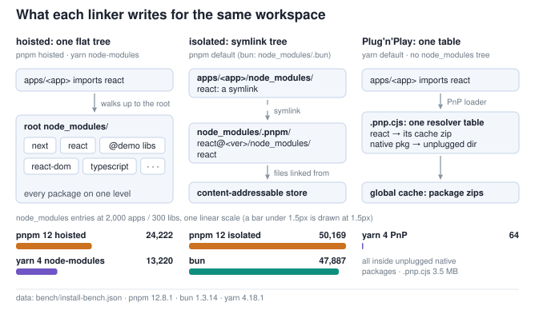

# Tooling Comparisons

Head-to-heads on installers, CI-runner installs, PnP compatibility, builds, lint, and task runners, each on its stated workload and machine. The fastest installer depends on scale and install state; oxlint leads ESLint on every measured lint pass.

## Install: bun vs pnpm vs yarn 4

`scripts/install-bench.mjs` installs [the workspace under test](README.md#the-workspace-under-test) at the table's apps/libs scales on the dedicated 64-core c7gd.metal ([README](README.md#the-64-core-machine)). Each manager runs its default and alternate linkers. Non-linker knobs are normalized across tools: dependency build scripts are disabled for every tool, and registries and caches are pinned (see the script header). bun and yarn ignore `pnpm-workspace.yaml`/`catalog:`, so the bench installs a decataloged copy. Tool versions are recorded and pin-asserted: pnpm 12.8.1 (the Rust CLI, probed through the per-scaffold `packageManager` pin), bun 1.3.14, yarn 4.18.1.

- pnpm-isolated (default) / pnpm-hoisted (flat)
- bun (isolated `node_modules/.bun` store since 1.3)
- yarn under `node-modules` (flat) and PnP (its default)

[High-resolution PNG](bench/charts/fig-linker-layouts.png)

**Figure 1.** A hoisted linker writes packages side by side into one root `node_modules` that an import reaches by walking up the tree; pnpm's isolated linker gives each package its own `node_modules` of symlinks into a virtual store whose files are linked from the content-addressable store; yarn PnP writes no `node_modules` tree, only a `.pnp.cjs` table that maps each import to its package's location — a zip in the global cache, a workspace directory, or an unplugged directory for a native package.

Figure 1 fields

`bench/install-bench.json`: `scales[].apps` and `scales[].libs` (the scale matrix; the figure draws the largest, 2,000 / 300), and at that scale `pnpmHoisted.nmEntries`, `yarnNm.nmEntries`, `pnpmIsolated.nmEntries`, `bun.nmEntries`, `yarnPnp.nmEntries`, `yarnPnp.pnpCjsBytes`; `pnpmVersion`, `bunVersion`, `yarnVersion`. An entry is a path under any `node_modules` directory.

**cold** = no lockfile; **warm** = lockfile present, `node_modules` removed; **truly-cold** = network-cold. Each cell is one sample, run in the listed tool order within each scale. Bold marks the fastest cold and warm cell per scale. yarn-PnP's 64 entries are paths inside its unplugged native packages.

| scale | manager | cold | warm | CPU | peak RSS | nm entries |
|---|---|---|---|---|---|---|
| 200 / 100 | pnpm 12.8.1 isolated | 0.43s | **0.25s** | 430% | 91 MB | 15,701 |
| | pnpm 12.8.1 hoisted | 0.46s | 0.26s | 642% | 81 MB | 12,554 |
| | bun | **0.28s** | 0.27s | 169% | 44 MB | 15,419 |
| | yarn node-modules | 3.2s | 2.8s | 156% | 939 MB | 11,220 |
| | yarn PnP | 1.7s | 1.4s | 144% | 612 MB | 64 |
| 1,000 / 200 | pnpm 12.8.1 isolated | 2.1s | 2.5s | 196% | 135 MB | 31,133 |
| | pnpm 12.8.1 hoisted | **0.96s** | **0.59s** | 983% | 123 MB | 17,786 |
| | bun | 2.9s | 2.8s | 37% | 69 MB | 29,951 |
| | yarn node-modules | 4.3s | 3.9s | 159% | 1,019 MB | 12,120 |
| | yarn PnP | 2.3s | 2.1s | 152% | 663 MB | 64 |
| 2,000 / 300 | pnpm 12.8.1 isolated | 6.8s | 7.3s | 111% | 191 MB | 50,169 |
| | pnpm 12.8.1 hoisted | **2.5s** | **1.1s** | 700% | 174 MB | 24,222 |
| | bun | 8.6s | 8.8s | 24% | 94 MB | 47,887 |
| | yarn node-modules | 5.6s | 5.4s | 160% | 1,100 MB | 13,220 |
| | yarn PnP | 3.2s | 2.9s | 150% | 726 MB | 64 |

Truly-cold at 200/100 (one sample, network-bound): bun 1.3s, pnpm-hoisted 2.2s, yarn PnP 7.8s, yarn node-modules 9.2s.

- pnpm 12 (the Rust CLI) has no cold-resolve wall. Its cold install takes seconds at 81–191 MB peak RSS: 0.43s → 6.8s isolated (15.6× over 10× apps) and 0.46s → 2.5s hoisted (5.5×, sublinear). The pnpm-10-vs-12 comparison is [below](#pnpm-12-the-rust-rewrite).
- The bun-vs-pnpm cold order depends on scale. At 200/100 bun is ~1.6× faster (0.28s vs 0.43–0.46s) and ~1.7× faster truly-cold (1.3s vs 2.2s). At 1,000 apps both pnpm linkers and yarn-PnP are ahead of bun (pnpm-hoisted 0.96s vs 2.9s, ~3.1×; pnpm-isolated 2.1s; yarn-PnP 2.3s). At 2,000 bun's cold is the slowest of the five configurations (8.6s): pnpm-hoisted (2.5s) is ~3.4× faster, yarn-PnP (3.2s) second, pnpm-isolated (6.8s) 1.3×. bun's install CPU falls with scale (169% → 37% → 24%, under one core from 1,000 apps); pnpm-hoisted runs at 642–983%. Both yarn linkers grow under 2× across the 10× app sweep (PnP 1.7s → 3.2s, node-modules 3.2s → 5.6s).
- Warm relink exposes the linker. pnpm-hoisted is the fastest warm at 1,000 and 2,000 (0.59s, 1.1s), against 7.3s for pnpm-isolated at 2,000. At 200 the two pnpm linkers and bun are within about 8% (0.25–0.27s; pnpm-isolated fastest). bun's warm is within 4% of its cold at every scale (0.27s/2.8s/8.8s warm vs 0.28s/2.9s/8.6s cold).

**Specifier form** (`scripts/perf-matrix.mjs`, pnpm 12.8.1, cold at 300/100, one sample per variant): the `workspace:` form changes neither the lockfile line count nor the `node_modules` entry count, and the two cold installs are 0.62s (`workspace:*`) and 0.56s (`workspace:^x.y.z`), 11% apart; choose the form for publish semantics. The same record's linker variants reverse install-bench's hoisted-vs-isolated direction ([OPTIMIZATIONS.md §1.1](OPTIMIZATIONS.md#11-node-linker-mode)).

## pnpm 12: the Rust Rewrite

pnpm 12 is a Rust port of the pnpm CLI, shipped as a native binary. `scripts/pnpm12-bench.mjs`
prices it against the pinned JS pnpm on one 1,000:200 workspace per leg
(`bench/pnpm12-bench.json`, the dedicated 64-core box, btrfs). The generator's scale and
modules are pinned and its printed summary asserted. Every leg must lock the identical
package set (58 packages, 1,201 importers). Leg order rotates per sample round and is
recorded, and the shared `_verify-install.cjs` checks completeness after every timed install.

| row | pnpm 10.29.1 (JS) | pnpm 12.8.1 (Rust) | tip (12.8.2 @ 26aeeb11) |
|---|---|---|---|
| cold resolve (no lockfile, warm store; median of 3) | 307.4s | 0.93s | 0.92s |
| warm rebuild (lockfile + store, no `node_modules`; median of 3) | 5.07s | 0.52s | 0.52s |
| frozen rebuild (`--frozen-lockfile`, same tree; median of 3) | 4.86s | 0.49s | 0.49s |
| truly-cold (fresh store + cache + network; lockfile retained, frozen; 1 sample, fixed order) | 7.00s | 1.08s | 1.08s |

The rewrite is **331× faster on cold resolution**: the JS implementation spends five minutes
on this 1,201-importer workspace. It is 9.7× faster warm, 10.0× frozen, and 6.5× truly-cold.
Tip of main is within ±2% of stable on every row. These rows use this bench's own flags and
install-state definitions, so they are not directly comparable to the install-bench table
above; the containerized frozen install is in
[the CI-runner section](#the-ci-runner-install-frozen-in-a-fresh-container).

Migration (untimed verdicts in the record): pnpm 12 writes the same `lockfileVersion: '9.0'`,
and `--frozen-lockfile` against a pnpm-10-authored lockfile succeeds with the lockfile bytes
unchanged. A drifted manifest fails closed with `ERR_PNPM_OUTDATED_LOCKFILE`. Two defaults
are stricter: a blocked dependency build script fails the install in 12
(`ERR_PNPM_IGNORED_BUILDS`) where 10 flags it and exits 0 (the two-sided build-scripts probe),
and the supply-chain gate (`minimumReleaseAge`) fails lockfile verification closed for packages
published within its cutoff (`ERR_PNPM_MINIMUM_RELEASE_AGE_VIOLATION`); its trigger depends
on registry publish times relative to the run, so the bench sets
`--config.minimum-release-age=0` on every leg instead of gating on it. Both defaults change
CI behavior on upgrade, and both can be relaxed in config.

## yarn PnP toolchain compatibility

`scripts/pnp-compat-bench.mjs` (20 apps / 10 libs, PnP against a node-modules control): oxlint, tsc and turbo's focused typecheck run under PnP. **tsgo fails** (`TS2503`/`TS2307`) and **`next build` fails**: on node 22.23.3 it crashes loading `next.config`, before a bundler runs (below). Both work under node-modules. The PnP install itself depends on the yarn release when the checker is TypeScript 7. yarn 4.17.0's builtin TypeScript patch fails on the native `typescript@7.0.2` (`ENOENT` on `typescript/lib/_tsc.js`, a file TypeScript 7 does not ship), and the pinned 4.18.1 installs it (the bench's two-sided control, `bench/pnp-compat-bench.json`).

**Closing the gap:** a native PnP resolver for tsgo ([microsoft/typescript-go#460](https://github.com/microsoft/typescript-go/issues/460)) matches the node-modules control on one scaffolded app with a workspace lib and npm deps: 0 errors over 83 files, where stock tsgo reports three `TS2307` over 64 files (`scripts/tsgo-pnp-bench.mjs`, `bench/tsgo-pnp-bench.json`).

**Next under PnP depends on the node version.** `scripts/rspack-pnp-bench.mjs` builds one Next App Router app (next 16.0.1) with three builders, and builds each PnP tree twice: on the bench's node and on a pinned older node.

[High-resolution PNG](bench/charts/fig-next-pnp-node.png)

**Figure 2.** The node version decides how far `next build` gets under PnP: on the newer node the config load crashes before a bundler is selected, so the three builders fail identically, and on the older node the build reaches the bundlers, where the outcome is each bundler's own PnP resolution.

Figure 2 fields

`bench/rspack-pnp-bench.json`: per cell `matrix.{pnp,pnpControlNode,nm}.{turbopack,webpack,rspack}` — `linker`, `builder`, `ok`, `exit`, `outputPresent`, `configLoadCrash`, `pnpResolveFailure`, `turbopackBanner`, `rspackBanner`, `webpackCompilationSpan`; `dotNextPresent` on a config-load cell, `pnpResolveFailureLine` on the resolution-failure cell, `treeUnchanged` on the three `matrix.pnp` cells; `matrix.pnpControlNode.node`, `versions.node`, `versions.controlNode`, `versions.next`, `versions.yarn`, `canonical`.

| PnP tree, builder | node 22.23.3 | node 22.22.0 (control) | node-modules, node 22.23.3 |
|---|---|---|---|
| Turbopack | fails at config load | fails: no PnP resolver (`next/package.json`) | builds |
| webpack | fails at config load | builds | builds |
| rspack (`next-rspack`) | fails at config load | builds | builds |

The node 22.23.3 crash: next's config transpile hook reads `require.extensions['.js']`, which the `require()` it gets under the PnP loader does not carry. All three builders succeed under node-modules on the same node, so the crash is specific to PnP. Turbopack's failure on 22.22.0 is its missing PnP resolver ([vercel/next.js#42651](https://github.com/vercel/next.js/issues/42651)). `pnp-compat-bench` records the same config-load crash on its generated app (next 16.2.9) (`bench/rspack-pnp-bench.json`, `bench/pnp-compat-bench.json`).

**yarn 4 at fleet scale.** `scripts/yarn-fleet-bench.mjs` installs the [FLEET.md](FLEET.md) shape (30,000 apps / 460 libs, with the fleet gate's exact devDependency set) using yarn 4.18.1 on node 22.23.3, with `typescript@7` as the tree's checker (`bench/yarn-fleet-bench.json`; the dedicated 64-core box). PnP installs the workspace **truly-cold in 41.2s** (no lockfile, fresh global cache, network) and 38.0s warm, writing one 62MB `.pnp.cjs` instead of a `node_modules` tree. yarn's node-modules linker takes **203.5s** truly-cold and 197.3s warm on the same tree (4,884,956 `node_modules` entries). The fleet gate's bun 1.3.14 install of the same workload, in the state of yarn's warm rows (lockfile present, warm store, install outputs wiped), takes 180.8s on the same box (`bench/fleet-gate-bench.json`; one run per record). PnP warm is 4.8× faster than bun; yarn's node-modules linker warm is 9% slower.

The native-PnP tsgo build (head of the PR line consolidated in [microsoft/typescript-go#1966](https://github.com/microsoft/typescript-go/pull/1966); binary sha and git sha recorded) runs the whole-program fleet gate **through `.pnp.cjs` in 57.9s / 51.3GB, against 57.4s / 50.5GB for the same binary over the node-modules install**: 0.8% higher wall and 1.6% higher peak RSS. Each linker has one timed run, and the PnP run's source carries one additional unused foundation export (the scenario's non-breaking rev). The gate catches the breaking foundation rev with all 30,000 apps red in 57.6s. Stock tsgo on the same PnP tree fails with exactly 30,000 `TS2503` unresolved-name errors, the pnp-compat boundary at full scale. With the resolver in place, two things stand between this stack and PnP: `next build` (the table above) and the patch, which has not shipped.

## The CI-runner install: frozen, in a fresh container

`scripts/container-install-bench.mjs` installs a committed lockfile frozen (`pnpm --frozen-lockfile`, `bun --frozen-lockfile`, `yarn --immutable`, `npm ci`) in a fresh rootless-podman container at 1,000 apps / 200 libs, median of five. Versions: pnpm 12.8.1 on its default isolated linker only, bun 1.3.14, yarn 4.18.1; the image carries node 22.23.1 and npm 10.9.8. The box is the dedicated 64-core machine ([README](README.md#the-64-core-machine)) with podman's storage on its btrfs RAID0 (`bench/container-install-bench.json`).

On a fresh runner (empty caches, real network): **bun 0.93s, pnpm 1.03s (+11%)**, yarn-PnP 4.5s, yarn-nm 6.5s, npm 10.4s. Cache-restored: bun 0.42s, pnpm 0.50s (+19%), yarn-PnP 2.2s, yarn-nm 4.2s, npm 9.7s. All five fail closed on drift (exit 1, lockfile untouched).

## Build: Next vs Vite

`scripts/build-bench.mjs` runs `turbo run build` over 40 apps + 24 libs on 64 cores. Next (App Router): 15.1s, 747 MB RSS, 156.8 MB `.next`. Vite (SPA): 4.7s, 398 MB RSS, 7.7 MB `dist`. Vite builds ~3.2× faster and emits ~20× less for these tiny apps; the features differ (`.next` includes server/RSC bundles). At scale, not building unchanged apps matters more than per-build time (`bench/build-bench.json`).

**Build speed** (`scripts/rspack-turbopack-speed-bench.mjs`, 60-route app, node-modules, median of 3, `bench/rspack-turbopack-speed-bench.json`): Turbopack **8.7s** cold, rspack 15.5s (×1.78), webpack 19.1s (×2.20). rspack is ~1.24× faster than webpack cold.

## Lint: ESLint vs oxlint

`scripts/lint-bench.mjs` races oxlint (native Rust, from oxc; this repo's linter) against ESLint on a generated corpus of 800 `.ts`/`.tsx` modules, separate from the workspace under test, matched so the ratio measures engine speed. ESLint runs oxlint's rule set through `eslint-plugin-oxlint`: the 530 non-type-checked rules with an ESLint port, a strict subset of oxlint's own 598 (the two counts use different rule namespaces and are not directly comparable). oxlint is multithreaded and ESLint single-process; the bench ran on a 192-core c8g.48xlarge, and the ratio narrows on fewer cores. (`oxlint` 1.86.0, `eslint` 9.39.5, `oxlint-tsgolint` 7.0.2003.)

| pass                        | ESLint              | oxlint                | ratio |
| --------------------------- | ------------------- | --------------------- | ----- |
| syntactic, no cache         | 9,602ms (530 rules) | **190ms** (598 rules) | 50.5× |
| syntactic, ESLint `--cache` | 1,568ms             | **190ms**             | 8.3×  |
| type-aware                  | 3,566ms             | **388ms**             | 9.2×  |

The type-aware row includes type-program construction and lint-rule execution. oxlint's `oxlint-tsgolint` (alpha; 59 of 61 typescript-eslint type-aware rules; needs TS7+) builds its program with tsgo; ESLint uses TypeScript 5.9.3 in this lint benchmark. Separately, tsgo 7.0.2 is ~12× faster than tsc 6.0.3 on the 3,000-module whole-program benchmark (`bench/typecheck-bench.json`, [TYPECHECKERS.md](TYPECHECKERS.md)); that result does not decompose the lint timings. The migration path is oxlint on the hot path and an ESLint pass for the remaining rules: `eslint-plugin-oxlint` disables oxlint-covered rules, leaving ESLint to run the remaining rules (0 findings here).

## Vite+ (`vp`): task runner and tool layer

Vite+ is VoidZero's toolchain CLI: one `vp` binary wrapping Rolldown-Vite, Vitest, Oxlint, and **Vite Task**, a Rust monorepo task runner in Turborepo's role. Version 0.2.2, measured by `scripts/vite-task-bench.mjs` and `scripts/vite-plus-tools-bench.mjs`. The Vite+ layer costs time on every cold row and on the whole-repo warm typecheck; it is faster on the warm test run and on the focused warm typecheck at 1,000:200.

**Task orchestration** (`bench/vite-task-bench.json`; the workspace under test with a dep-free `typecheck:tsgo` task set; 192-core c8g.48xlarge, concurrency 192 on both runners, typescript 7.0.2). turbo hashes declared inputs; Vite Task traces file reads and cached the gitignored tree with zero config. On the whole-repo typecheck turbo wins cold ×8.4 at 300:100 (5.2s vs 43.5s) and ×10.7 at 1,000:200 (19.1s vs 204.2s), warm ×3.2 (1.4s vs 4.5s) and ×4.1 (3.5s vs 14.5s). Focused warm is close: vp stays flat across 3× repo growth (0.81s → 0.83s) while turbo's grows with the repo (0.76s → 1.01s, [LIMITS.md](LIMITS.md)), so turbo leads at 300:100 and vp by 1.2× at 1,000:200. Focused cold, turbo is faster at both scales (1.4s vs 2.3s; 1.5s vs 2.0s). After a cross-package edit (1,000:200), vp recomputed exactly the 559 tasks whose traced reads touch the file; turbo recomputed 1 of 1,200 because this dep-free setup removes its `^build` dependency edge (turbo's cross-package invalidation comes from dependency edges or `globalDependencies`). On the test axis (1,200 `node:test` tasks at 1,000:200) turbo is faster cold (7.1s vs 17.6s) and vp faster warm (1.0s vs 2.8s). vp refuses to cache self-mutating tasks (`next build`, `vite build`, `tsc --noEmit` with `incremental: true`).

**Tool layer** (`bench/vite-plus-tools-bench.json`, self-contained temp scaffolds, the dedicated 64-core box). `vp check --no-fmt` (one pass) takes 2.35s against **1.68s** for the same engines standalone (`oxlint --type-aware --type-check`). This repo's gate (`oxlint` + whole-program `tsgo --noEmit`) takes **0.42s** with a different type-check model (one tsgo program over lib source, against tsgolint's per-file typed lint), so the 5.6× between it and `vp check` is not a like-for-like engine comparison. `vp build` and `vite build` on one generated Vite app produce byte-identical `dist` in 792ms vs 367ms (~2.2× wrapper cost).
