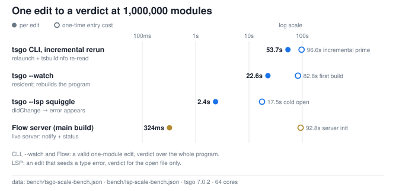
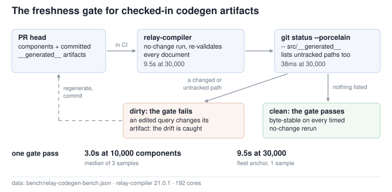

# Faster Type-Checking

tsgo checks ~12× faster than tsc and stays near-linear to a million modules; Flow uses about a third of tsgo's memory, and its resident server answers one edit in 324ms at 1M. Whole-repo type-checking is O(repo): the first lever is checking less (`turbo --affected`), the second is making each check cheaper.

## tsc vs tsgo

`scripts/typecheck-bench.mjs` times `--noEmit` over one N-module program, median of five runs: tsgo (`typescript@7`'s native `tsc`, pinned at 7.0.2) against tsc (TypeScript 6, the last JS release, installed as the `typescript6` alias).

| modules | tsc | tsgo | speedup |
|---|---|---|---|
| 3,000 | 3,062ms | 257ms | 11.9× |

Consistent with Microsoft's ~10× claim. The tsgo name is retired upstream; this repo keeps `tsgo` as the task and record label. For modern configs the native `tsc --noEmit` drops into the per-package Turborepo task. It drops some legacy config (bare `baseUrl`, `moduleResolution: node10`, older `target`s), has no plugin API, and ships no tsserver, so TypeScript 6 stays installed for tsserver and as the oracle. With both majors installed, `node_modules/.bin/tsc` is ambiguous; every bench resolves both checkers by direct path (`scripts/_ts.mjs`) and asserts the version before timing.

## Behavior at a Million Files: tsgo vs tsc vs Flow

`scripts/tsgo-scale-bench.mjs` sweeps one growing generated program (a standalone corpus, not the workspace) through 10k, 100k, 250k, 500k, and 1,000,000 modules for **tsgo**, **tsc** (anchored ≤100k), and **Flow**.¹ Record: `bench/tsgo-scale-bench.json`, on the dedicated 64-core arm64 box ([README](README.md#the-64-core-machine)).

> High-resolution PNG: [`bench/charts/checker-scale.png`](bench/charts/checker-scale.png) (`make scale-chart`).

<!-- chart-data:checker-scale -->

The numbers as tables (fastest in bold; readable on a phone)

tsgo 7.0.2 · tsc 6.0.3 (64GB heap) · flow main @ cdb4f637 (wedge fixes in) · 64-core host. Each cell: the measured time, then its multiple of the row's fastest. The red-vs-green row compares a failing run with a passing one; it is not a ranking.

**Whole-program check: tsgo, tsc, Flow**

|  | tsgo | tsc | Flow |
| --- | ---: | ---: | ---: |
| 10k modules | **600ms** | 7.40s (×12) | 910ms (×1.5) |
| 100k modules | **6.05s** | 65.0s (×11) | 9.57s (×1.6) |
| 250k modules | **16.0s** | — (anchor ≤100k) | 23.2s (×1.4) |
| 500k modules | **33.4s** | — (anchor ≤100k) | 45.7s (×1.4) |
| 1,000,000 modules | **70.7s** | — (anchor ≤100k) | 92.5s (×1.3) |

[`bench/tsgo-scale-bench.json`](bench/tsgo-scale-bench.json). Warm full check, no incremental state. tsc stops at the 100k anchor: a cost cutoff, not a capacity limit. Flow is a build of flow main with the wedge fixes (provenance in the JSON); released 0.321's server crashes at this scale (last section).

**A failing check costs what a passing one costs**

|  | tsgo (1M modules) | tsc (100k modules) | Flow (1M modules) |
| --- | ---: | ---: | ---: |
| red check vs green check | -0.5% (70.3s vs 70.7s) | +0.8% (65.5s vs 65.0s) | +1.0% (93.5s vs 92.5s) |

[`bench/tsgo-scale-bench.json`](bench/tsgo-scale-bench.json). Each cell: the red run against the green run, at the checker's largest measured scale. The red run seeds 3 errors in zero-dependent leaf modules and must exit nonzero reporting exactly those errors.

**One edit to a verdict: the save loop, by mechanic**

|  | tsgo --lsp squiggle | tsserver squiggle | flow server edit | tsgo --watch | tsgo CLI incremental | tsc CLI incremental |
| --- | ---: | ---: | ---: | ---: | ---: | ---: |
| 10k modules | **18ms** | 85ms (×4.7) | 19ms (×1.1) | 200ms (×11) | 430ms (×24) | 3.05s (×169) |
| 100k modules | 208ms (×3.9) | 938ms (×18) | **53ms** | 1.69s (×32) | 4.10s (×77) | 23.4s (×441) |
| 250k modules | 416ms (×4.6) | — (anchor ≤100k) | **90ms** | 4.73s (×53) | 12.0s (×133) | — (anchor ≤100k) |
| 500k modules | 977ms (×6.0) | — (anchor ≤100k) | **163ms** | 10.0s (×62) | 25.3s (×155) | — (anchor ≤100k) |
| 1,000,000 modules | 2.36s (×7.3) | — (anchor ≤100k) | **324ms** | 22.6s (×70) | 53.7s (×166) | — (anchor ≤100k) |

[`bench/tsgo-scale-bench.json`](bench/tsgo-scale-bench.json), [`bench/lsp-scale-bench.json`](bench/lsp-scale-bench.json). Squiggle: the asserted didChange → TS2322 → clear transition on a live server. Flow server: a force-recheck + status round-trip. CLI: a relaunch on warm incremental state. Released Flow 0.321's server wedges under overlapping edits at this scale (facebook/flow#9454, last section).

**Completion: different result sets, reported with counts**

|  | tsgo --lsp | tsserver |
| --- | ---: | ---: |
| 10k modules | 370ms (×22) | **17ms** |
| 100k modules | 51.3s (×2,564) | **20ms** |
| 250k modules | ≥2m (timed out) | — (anchor ≤100k) |
| 500k modules | ≥2m (timed out) | — (anchor ≤100k) |
| 1,000,000 modules | ≥2m (timed out) | — (anchor ≤100k) |

[`bench/lsp-scale-bench.json`](bench/lsp-scale-bench.json). Not like-for-like: tsgo returns the full exported-symbol space (31,058 items at 10k, 301,058 at 100k); tsserver returns a bounded 1,067-entry set. The × prices the response a user waits for. From 250k up tsgo exceeds its 120s request ceiling; tsserver stops at the 100k anchor.

**Flow's wedge under edit pressure: released 0.321.0 vs flow main**

|  | flow main @ cdb4f637 | released 0.321.0 |
| --- | ---: | ---: |
| recheck round-trip (storm, median) | **520ms** | 3.30s (×6.3) |
| overlapping-edit storm, 20 cycles | 20/20 clean (no panic) | wedged (at cycle 13) |

[`bench/flow-wedge-retest.json`](bench/flow-wedge-retest.json). Storm: a second edit lands 120–480ms into an in-flight recheck, the trigger behind all three recorded wedges. 500k corpus. Released 0.321 wedges with a WorkerCanceled panic. Settled sequential edits never trigger it on either binary. Fix verified on flow main (facebook/flow#9454).

<!-- /chart-data:checker-scale -->

The corpus is **fixed-depth**: 100 layers, each module importing ≤3 from the layer below, so width grows to 1M while depth stays constant, as in a real monorepo. Each checker gets six rows (cold, full, incrNoChange, incrOneEdit, and two red paths), gated on a seeded red error and an exact `--listFiles`/`flow ls` count.

### Full Check, Median Wall Time

| modules | tsgo full | tsgo cold | tsc full | flow full | flow cold |
|---|---|---|---|---|---|
| 10,000 | 0.60s | 0.73s | 7.4s | 0.91s | 1.27s |
| 100,000 | 6.1s | 7.1s | 65.0s | 9.6s | 10.1s |
| 250,000 | 16.0s | 18.8s | anchor cutoff | 23.2s | 24.8s |
| 500,000 | 33.4s | 40.0s | — | 45.7s | 46.8s |
| 1,000,000 | 70.7s | 84.8s | — | 92.5s | 94.0s |

¹ Flow is a main-branch build. Released Flow through 0.321 has a recheck-cancellation race that silently wedges its server at this scale, in 3 of 5 sweeps ([facebook/flow#9454](https://github.com/facebook/flow/issues/9454), fixed on main; retest with `scripts/flow-wedge-retest.mjs`, evidence in `bench/flow-0321-wedge-evidence.md`).

tsgo is **near-linear**: 60ms per thousand modules at 10k, 71ms at 1M. At 1M Flow's full check is +31% of tsgo (92.5s vs 70.7s); at the 100k anchor tsc is 11× (65.0s vs 6.1s).

### Red rows, memory, developer loops

- **A failing gate costs what a passing one costs.** At 1M tsgo takes 70.3s red vs 70.7s green, and Flow 93.5s vs 92.5s; tsc takes 65.5s vs 65.0s at its 100k anchor.
- **Memory** (peak RSS, full check): tsgo ~54KB/module (53.7GB at 1M), Flow ~17KB/module (17.1GB), tsc ~67KB/module at its 100k anchor (6.7GB). No memory cliff on this 135GB box.
- **The save loop** depends on the mechanic (Figure 1). tsgo's CLI incremental costs 38.0s no-change and 53.7s one-edit at 1M: a CI tool, not a save loop. Flow's persistent server answers **one edit in 324ms at 1M** (19ms → 324ms across 100×), the fastest measured.

[High-resolution PNG](bench/charts/fig-save-loop.png)

**Figure 1.** The four mechanics differ in what they redo after an edit: the CLI relaunches and re-reads its saved incremental state, `--watch` stays resident but rebuilds the program, the LSP recomputes diagnostics for the open file only, and Flow's server keeps the checked program resident and rechecks incrementally.

Figure 1 fields

`bench/tsgo-scale-bench.json`, `points.1000000`: `tsgo.incrOneEdit.{killed,medianMs}`, `tsgo.incrPrimeMs`, `flow.incrOneEdit.{killed,medianMs}`, `flow.serverInitMs`; `versions.tsgo`, `versions.flow`, `cores`, `layers`, `tsgoInvocation`. `bench/lsp-scale-bench.json`, the `results` entry whose `modules` is 1,000,000: `tsgoWatch.oneEditRecheckMs`, `tsgoWatch.firstBuildMs`, `tsgoLsp.warm.errorAppearsMs`, `tsgoLsp.cold.coldOpenMs`; `meta.cores`, `meta.layers`, `meta.tsgoInvocation`, `meta.tsgoVersion`. The two records are drawn on one axis on the fields they share (cores, corpus depth, tsgo version and invocation); `lsp-scale-bench.json` records no architecture, mount or node version.

### The daemons and codegen

**Daemons** (`scripts/lsp-scale-bench.mjs` → `bench/lsp-scale-bench.json`). tsgo's `--lsp` serves the million-module program: 17.5s cold open, 2.4s to the squiggle, 68.0GB RSS. At the 100k anchor its cold open is **17× faster than tsserver's** (1.5s vs 24.3s). tsgo LSP completion grows with N: 301,058 items at 100k, past the 120s ceiling from 250k up. tsserver stays at 1,067 items in 17–20ms. The editor loop on one app's closure is in [LIMITS.md](LIMITS.md#editor-and-language-server).

**Codegen** (`scripts/relay-codegen-bench.mjs` → `bench/relay-codegen-bench.json`; 192-core c8g.48xlarge, tsgo 7.0.2). relay-compiler runs over a 10,000-component tree in both dialects. Codegen (~2.9s) dominates the checker: 0.91s for tsgo, 1.7s for Flow (released 0.321 via `flow-bin`; the main-branch build matters only at wedge scale). Checked-in artifacts hold up: the CI freshness gate (Figure 2) costs 3.0s at 10k components and detects an edited query. At the 30,000-component fleet anchor the same git-tracked freshness pass costs 9.5s (codegen 9.48s + status 0.04s; 9.3s cold, one sample). Committing artifacts keeps the type gate build-free for ~10s of CI per pass.

[High-resolution PNG](bench/charts/fig-freshness-gate.png)

**Figure 2.** Relay's output is byte-stable on every timed no-change rerun, so a codegen run over an up-to-date tree leaves `git status --porcelain` over `__generated__` with nothing to list, and any listed path — changed, or new and untracked, which a plain diff would miss — means a query and its committed artifact have drifted.

Figure 2 fields

`bench/relay-codegen-bench.json`: `components`, `samples`, `schemaTypes`, `freshness.gateMedianMs`, `freshness.gateSamplesMs`, `freshness.byteStable`, `freshness.driftDetected`; `fleetPoint.components`, `fleetPoint.samples`, `fleetPoint.codegenNoChangeMs`, `fleetPoint.statusMs`, `fleetPoint.freshnessMs`, `fleetPoint.byteStable`; `versions.relayCompiler`, `cores`.

## Flow on the Fleet Shape

`scripts/fleet-flow-bench.mjs` mirrors the measured fleet workspace ([FLEET.md](FLEET.md), 30,000 apps / 460 libs) in Flow's dialect as 876,440 `// @flow` files (every workspace module plus a typed entry per app) derived from the generated tree's own manifests. Every workspace import edge carries over, including the oven-sh/bun#36386 app rename. The mirror is not file-for-file. It omits each app's Next layout and the Next/React ambient type surface the TS program carries (~936k workspace files plus external `.d.ts`), so the time and memory rows compare Flow's mirror against tsgo's somewhat larger program. The breaking rev shows the workspace graph's fidelity: **both checkers flag exactly 30,171 call sites**, each in its own dialect. App entries are typed function compositions, not JSX. Package imports resolve via `module.name_mapper`, with no install. The checker is the Rust-port build with the wedge fixes, provenance recorded.

Records: `bench/fleet-flow-bench.json` on the dedicated 64-core c7gd.metal ([README](README.md#the-64-core-machine)), and `bench/fleet-flow-bench.pbox.json` on a 192-core c8g.48xlarge. That record carries the core count, not the instance type. It ran with `FLEET_FLOW_WORK` overridden and otherwise identical knobs, with a deliberate 12-thread nice-19 CPU keep-warm on that box and a recorded pre-run 1-minute load of 7.8. The tsgo column is the 64-core fleet-gate record (`bench/fleet-gate-bench.json`, typescript 7.0.2):

| row | tsgo (fleet gate) | Flow, 64-core | Flow, 192-core |
| --- | --- | --- | --- |
| whole-program check | **58.1s** / 51.3GB | 79.7s / **20.1GB** | 78.9s / 22.8GB |
| breaking rev → 30,000 apps red (batch) | **58.9s** | 89.9s | 82.0s |
| server init (one-time) | — | 79.7s / 20.0GB | 75.5s / 22.7GB |
| status, nothing changed | — | **45ms** | 54ms |
| foundation edit, stays green | — | 9.3s | 15.4s |
| **foundation edit → 30,000 apps red (incremental)** | — | **14.9s** | 13.1s |

tsgo wins the batch rows in the fleet's actual dialect: 1.4× on the check and 1.5× on the batch breaking rev, on the same 64-core box. Flow holds the mirrored program in **2.6× less memory**.

Flow's resident server changes the foundation owner's loop: the full-fleet breaking verdict costs **14.9s incrementally** against tsgo's 58.9s per batch run. At the million-file scale, tsgo's `--watch` rechecks in ~23s by rebuilding the program; its LSP reports diagnostics for open files rather than a whole-project verdict (`bench/lsp-scale-bench.json`).

Three times the cores buys neither checker more than 12% on any row (tsgo's check and breaking rev are 15% slower on the 192-core c8gb.48xlarge, 66.6s / 67.7s in `bench/fleet-gate-bench.pbox.json`), matching the fleet gate's result; one run per machine.

A universal-lib edit costs 9–15s even incrementally, because blast radius binds every checker. The sub-second edit loops measured at 1M modules were minimal-invalidation edits with nothing downstream to recheck: a non-exported const on a mid-corpus module, and an error seeded in a zero-dependent leaf. The fleet rev changes an exported surface every app imports.

## Ranked Levers

1. tsgo: ~10× per check, drop-in for modern configs; pin the exact version.
2. Cheap config: `skipLibCheck: true`; `incremental: true` with `tsBuildInfoFile` in Turborepo `outputs`; `"types": []`; `turbo --affected`.
3. Do not adopt TS project references with Turborepo. They add a second config and cache layer, and `composite` forces `.d.ts` emit on every package, heavier than `--noEmit`.

`isolatedDeclarations` (TS 5.5) enables parallel `.d.ts` emit, but only where declarations are emitted (library builds). swc, esbuild, oxc, and Biome transpile or lint; they do not type-check. stc is archived and ezno experimental, so tsc and tsgo are the complete options.

**Sources:** [TypeScript native port](https://devblogs.microsoft.com/typescript/typescript-native-port/), [TS 7 beta](https://devblogs.microsoft.com/typescript/announcing-typescript-7-0-beta/), [Turborepo TS guide](https://turborepo.dev/docs/guides/tools/typescript), [Performance wiki](https://github.com/microsoft/TypeScript/wiki/Performance).
